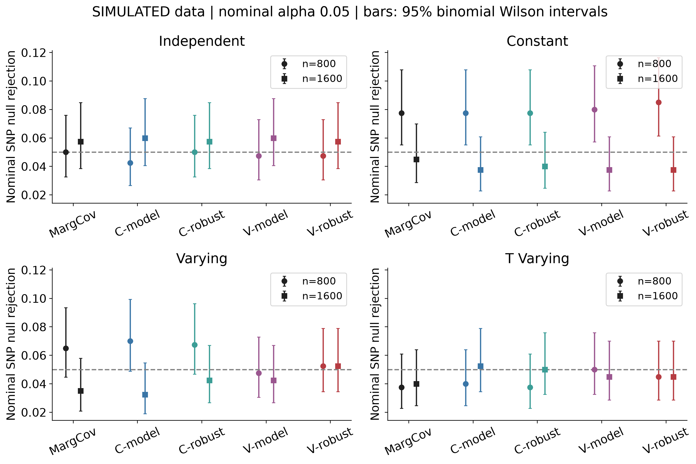
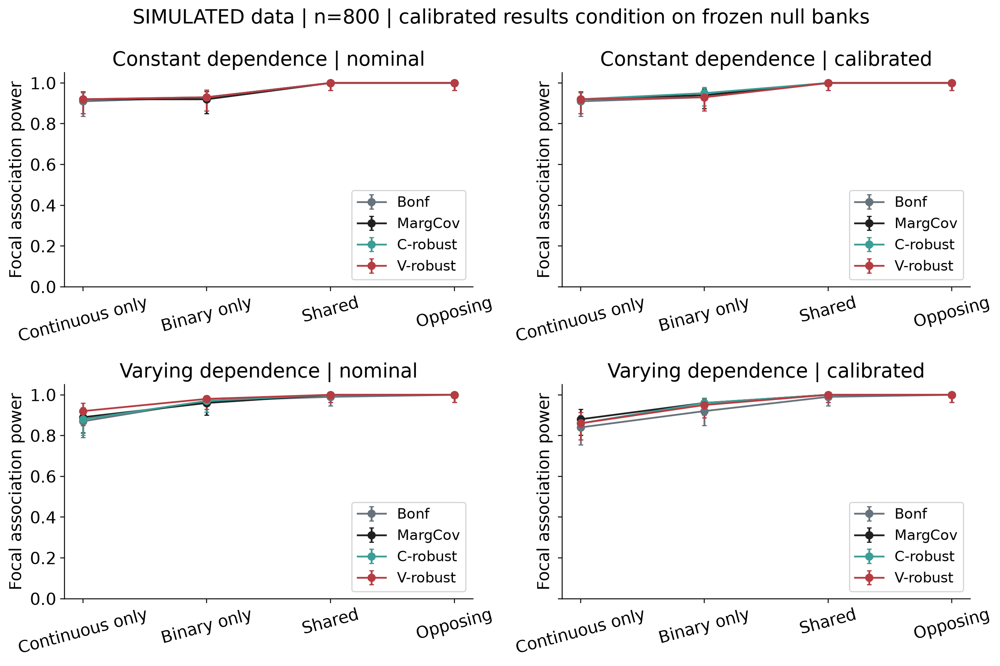
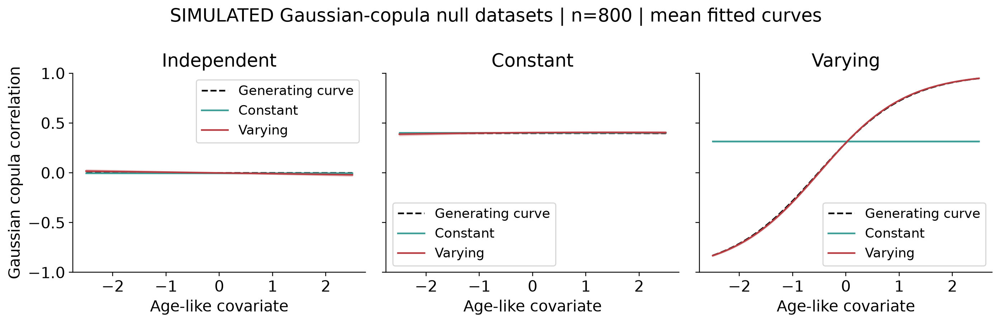
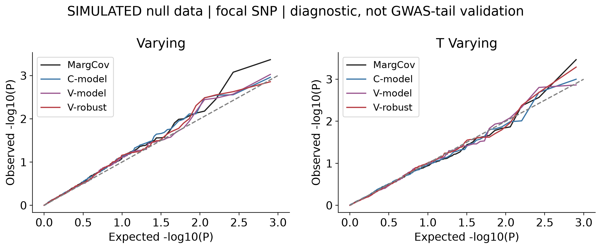
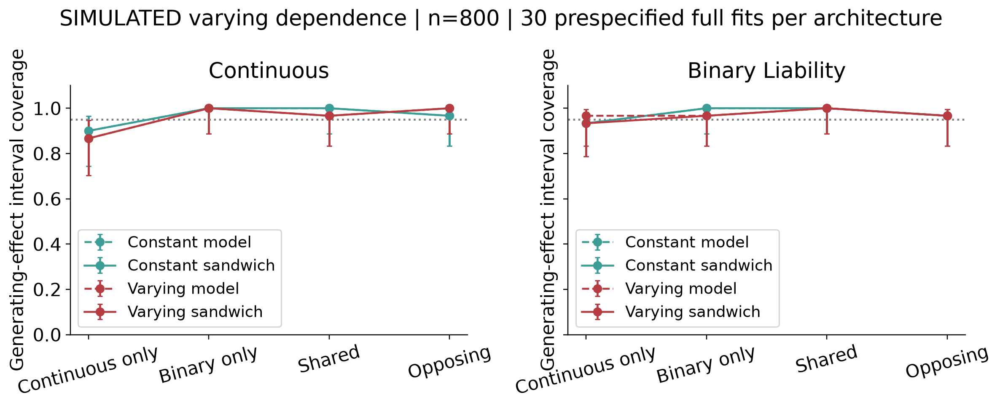
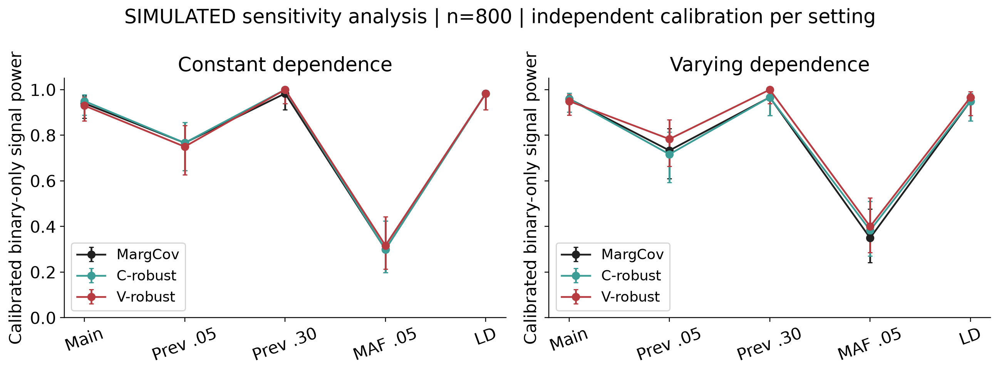
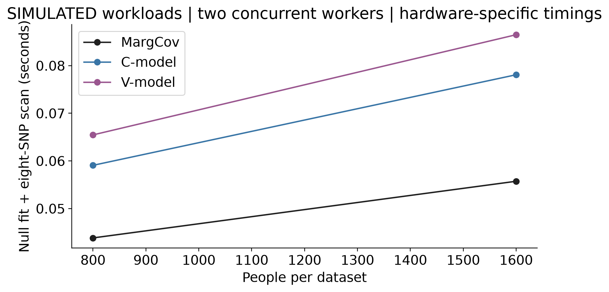

# Covariate dependent copula score tests for joint genetic association

**Vusumuzi Mabasa**

**Simulation study.** Both outcomes, all genotypes and all covariates are synthetic. The continuous outcome is cardiometabolic-like and the binary outcome is mental-health-like; neither is an observed clinical measurement or diagnosis. There are no patient data, biological discoveries or Genomic SEM analyses.

[Word manuscript](report/CardioMental_Copula_GWAS_Report.docx) · [Protocol](protocol/design.json) · [Audited score results](results/score_summary.csv) · [Paired comparisons](results/paired_contrasts.csv) · [Workflow](workflow.txt)

<!-- manuscript -->

## Abstract

**Background.** Joint genetic association tests can use dependence between continuous and binary outcomes, but a more detailed dependence model need not improve calibrated detection. This study evaluates constant and age-dependent Gaussian-copula score formulations against covariance-aware marginal testing.

**Methods.** A version-controlled protocol preceded the main simulations. Eight primary strata crossed sample sizes 800 and 1,600 with independence, constant Gaussian dependence, varying Gaussian dependence and a varying t copula with normal margins. Eight sensitivity strata examined outcome prevalence, allele frequency and simulated LD. Independent null banks of 200 datasets per stratum froze empirical p-value cutoffs before the corresponding evaluations. Seven association procedures were evaluated on identical datasets. Full effect-model fits used prespecified replicate indices regardless of significance.

**Results.** The benchmark comprised 13120 datasets: 3,200 calibration datasets and 9920 evaluation datasets, yielding 69440 method records and 555520 variant scores. There were 0 focal evaluation-score failures and 0 full-effect-fit failures. At n=800 under varying Gaussian dependence, the varying sandwich score had nominal null rejection 0.052 and independently calibrated rejection 0.028. Its calibrated binary-only power was 0.950, versus 0.960 for constant sandwich testing and 0.960 for covariance-aware marginal testing. The paired varying-minus-constant power difference was -0.010, with conditional 95% Monte Carlo interval -0.030 to 0.010.

**Conclusion.** The experiment quantifies how dependence specification and variance estimation affect association testing under controlled conditions. Numerical validation, nominal calibration and calibrated power are distinct findings. Results do not establish universal superiority, genome-wide tail accuracy, pleiotropy or clinical disease relationships.

## Introduction

Cardiometabolic measurements and mental-health outcomes can be observed in the same people and have different measurement scales. A joint distribution can represent their conditional dependence while retaining separate SNP effects. The methodological question is whether that representation improves association testing over suitable marginal and covariance-aware alternatives.

Copula-based mixed-outcome regression is established [1], as are copula genetic-association procedures. CBMAT is a variant-set score-type method [2], whereas the present target is a focal single-SNP omnibus null. ApproxCopula supplies another established distributional approach and a GWAS application [3]. It is not identical to an exact Gaussian copula because its construction can alter the margins. Neither published method is claimed as newly invented here, and neither external package was executed as a direct comparator in this first experiment.

The study concentrates on a narrower question: does accounting for covariate-dependent phenotype dependence change size, power and effect estimation when the underlying SNP effects and conditional margins are controlled? It is an implementation and operating-characteristic study, not a claim of a new general copula framework.

## Methods

### Simulation design and estimands

The design was frozen in [commit fe4bb39](https://github.com/Vusumuzi2Mabasa/CardioMental-Copula-GWAS/commit/fe4bb394d4a33847d00d7559f2a1371b5342afad) before the main simulation. This is a version-controlled protocol, not a registered clinical study. The primary design used eight common SNPs with minor-allele frequency 0.25 and binary prevalence 0.15. Four effect alternatives were continuous-only, binary-only, shared and opposing; only the focal SNP had a generating effect. Sensitivities used prevalence 0.05 or 0.30, MAF 0.05, or correlated genotypes, each under constant and varying dependence at n=800.

People are independent. The age-like covariate is a standard normal draw clipped at -2.5 and 2.5; exposure is Bernoulli(0.5) minus 0.5. Both enter both fitted marginal means. For centered focal genotype g and standardized residual margins,

$$
Y_i=0.35a_i+0.25e_i+\beta_1g_i+Z_{i1},
\qquad
D_i=\mathbf{1}\{b_0+0.25a_i+0.4e_i+\beta_2g_i+Z_{i2}>0\}.
$$

The generating effects are (0,0), (0.20,0), (0,0.35), (0.20,0.35) and (0.20,-0.35). Binary coefficients are probit-liability effects per allele, not log odds ratios. The binary intercept is calibrated by population quadrature independently of each evaluation dataset. Achieved case counts are retained per dataset.

For Gaussian copulas, dependence is zero, constant 0.4, or

$$
\rho_i=\tanh\{\operatorname{atanh}(0.3)+0.6a_i\}.
$$

The misspecified environment instead uses a t copula with four degrees of freedom and the same varying latent correlation parameter, transformed to normal univariate residual margins. This changes dependence without deliberately changing the univariate residual distributions. A fitted Gaussian rho is not the same parameter as the t-copula latent correlation.

Independent genotypes are Binomial(2,MAF). The LD sensitivity adds two independent haplotypes obtained by thresholding latent Gaussian vectors with AR(1) correlation 0.6. That number describes latent-normal correlation, not the resulting diploid LD. No external LD reference, real haplotype panel or ancestry comparison is used.

The primary null is

$$
H_{0j}:\beta_{j1}=\beta_{j2}=0.
$$

Rejecting it supports association with at least one outcome. It does not establish effects on both, a shared causal variant, or a causal relationship between diseases. The study scans a small panel; it is not an executed genome-wide discovery analysis.

### Exact mixed-outcome likelihood

Let the continuous margin have mean mu and standard deviation sigma, and let eta be the binary probit predictor. Write z=(y-mu)/sigma, t=2d-1 and s=sqrt(1-rho squared). The per-person log likelihood is

$$
\ell_i=-\log\sigma-\tfrac12 z_i^2-\tfrac12\log(2\pi)
 +\log\Phi\left\{t_i\frac{\eta_i+\rho_i z_i}{\sqrt{1-\rho_i^2}}\right\}.
$$

This uses the binary outcome's probability, not a continuous copula density evaluated at 0 or 1. The fitted models share Gaussian and probit marginal predictors. The dependence model is either constant or has an intercept and age slope on the Fisher transformation scale; independence fixes rho to zero.

For a=(eta+rho z)/s and k=t phi(a)/Phi(t a), the continuous-mean and binary-predictor scores are

$$
s_{\mu i}=\frac{z_i-k_i\rho_i/s_i}{\sigma},
\qquad
s_{\eta i}=\frac{k_i}{s_i}.
$$

Stable normal-tail calculations avoid probability underflow. Null fitting uses bounded L-BFGS-B with analytic gradients, recorded convergence checks and a deterministic rescue start. Boundary solutions and non-positive or ill-conditioned information matrices are explicit failures.

### Nuisance-adjusted association tests

The SNP score contribution is g times the two marginal-predictor scores. Let nu denote all nuisance parameters, H the negative observed Hessian under the fitted null, and U the summed score. We use

$$
A_j=H_{\beta\nu}H_{\nu\nu}^{-1},\qquad
U_{j,\mathrm{eff}}=U_\beta-A_jU_\nu,
$$

$$
H_{j,\mathrm{eff}}
=H_{\beta\beta}-H_{\beta\nu}H_{\nu\nu}^{-1}H_{\nu\beta},
\qquad
T_{j,\mathrm{model}}
=U_{j,\mathrm{eff}}^\top H_{j,\mathrm{eff}}^{-1}U_{j,\mathrm{eff}}.
$$

This is the observed-information analogue of the efficient score construction, asymptotically equivalent to the information-based score test under suitable correct-model regularity. Nuisance cross-derivatives are retained; simply treating fitted dependence as known would be a different test.

The sandwich alternative uses individual adjusted scores

$$
\psi_{ij}=s_{\beta,ij}-A_js_{\nu,i},\qquad
V_j=\sum_i\psi_{ij}\psi_{ij}^{\top},
\qquad
T_{j,\mathrm{sandwich}}=U_{j,\mathrm{eff}}^\top V_j^{-1}U_{j,\mathrm{eff}}.
$$

Two-degree-of-freedom chi-square reference p-values are used when information is full rank and regularity is appropriate. Sandwich variance is not a general remedy for confounding, biased scores, ascertainment or unidentified parameters. Those conditions are not validated by this experiment.

Seven procedures are compared: separate marginal scores with Bonferroni adjustment; a covariance-aware omnibus test of stacked marginal scores; the independence likelihood score without cross-outcome variance correction; and constant/varying copula scores with model or sandwich variance. The first three share their fitted marginal models. The independence likelihood is an informative misspecification comparator, not the sole benchmark against which complexity is judged.

Continuous and binary null-model nuisance estimates are reused across the eight fully observed markers in each dataset. A real implementation with genotype-dependent missingness would need to handle changing participant subsets explicitly.

### Calibration and independent evaluation

Each primary stratum contains 200 calibration nulls, 400 evaluation nulls and 100 evaluation datasets for each of four alternatives. Each sensitivity stratum contains 200 calibration nulls, 200 evaluation nulls and 60 per alternative. Calibration and evaluation use distinct master seeds and additional stratum, replicate and architecture identifiers.

For each method and stratum, the 10th smallest p-value among 200 calibration null datasets is frozen; evaluation rejects strictly below that cutoff. Under exchangeability across calibration and evaluation banks this rank targets 10/201, approximately 0.05, averaged over possible calibration banks. Ties are conservative. Conditional size with a particular frozen bank can differ, so held-out null rejection is reported rather than forced to 0.05.

Nominal tests at 0.05 and 0.01 remain visible separately. Empirical calibration is a simulation diagnostic, not a proposed clinical GWAS threshold. No claim is made about accuracy at 5e-8. Eight-marker family-wise null diagnostics use the nominal Bonferroni threshold 0.05/8 and are also not genome-wide validation.

Any failed calibration fit disables that arm's empirical cutoff. Evaluation failures remain in attempted-dataset denominators as non-rejections, alongside explicit failure counts and valid-fit counts. A method with many failures must not be described as well calibrated merely because its rejection rate is low.

### Effect estimation and Monte Carlo uncertainty

Score tests do not themselves supply alternative-model effect estimates. Full constant and varying likelihoods are therefore fitted to the first 30 replicates per primary scenario and first 10 per sensitivity scenario, regardless of significance. Bias and RMSE compare with generating effects. Model and sandwich Wald intervals are evaluated empirically; under misspecification, sandwich covariance need not make intervals cover the generating parameter.

For an empirical rejection rate r across B independent datasets, its estimated Monte Carlo SE is the sample standard deviation of the rejection indicators divided by sqrt(B). Rate and coverage plots use 95% binomial Wilson intervals, which remain informative when all observed indicators are zero or one. Paired comparisons first calculate within-dataset differences, then their mean and Monte Carlo SE; their reported intervals use mean plus or minus 1.96 SE. A zero paired plug-in SE means no observed discordance and does not establish equivalence. These measures describe simulation uncertainty conditional on the frozen calibration bank; calibration-bank variability is not included. Comparisons are descriptive and are not multiplicity-adjusted claims of a globally best method [4].

### Numerical validation and reproducibility

Analytic gradients were checked against finite differences; the maximum discrepancy was 0.00000000004. Controls also checked likelihood normalization, the independence limit, allele-flip invariance and equivalence between the block score construction and an expanded joint Hessian. Independent base-R likelihoods, BFGS optimization and numerical derivatives reproduced score calculations and full-effect estimates; the maximum full-effect difference was 0.000000233.

The primary simulation engine is Python; R supplies independent numerical validation, not a second set of substituted benchmark results. Source hashes tie the calibration and evaluation outputs to the exact core implementation. An independent audit reconstructs decisions, checks all output hashes, verifies unique evaluation fingerprints and regenerates null and shared datasets in every stratum.

## Results

### Numerical agreement and complete accounting

All numerical controls and the independent R check passed. The completed benchmark retained 9920 evaluation datasets with unique fingerprints, 69440 method records and 555520 per-variant scores. Calibration had 0 failed focal scores; evaluation had 0 failed focal scores. There were 0 failed full-effect fits. Complete statuses, rather than only successful runs, remain in the cell output files and the [audit](results/audit.json).

These checks establish implementation agreement and accounting. They do not establish statistical calibration or external clinical validity.

### Held-out null association

Under varying Gaussian dependence at n=800, constant-model nominal rejection was 0.070, while varying-sandwich nominal rejection was 0.052 and its calibrated rejection was 0.028. Both the dependence specification and the variance construction must therefore be considered when interpreting power.

|Generating dependence|MargCov nominal|C-model nominal|V-model nominal|V-robust nominal|V-robust calibrated|
|---|---|---|---|---|---|
|independent|0.050|0.043|0.048|0.048|0.060|
|constant|0.077|0.077|0.080|0.085|0.085|
|varying|0.065|0.070|0.048|0.052|0.028|
|t_varying|0.037|0.040|0.050|0.045|0.043|

Table 1. Focal-SNP null rejection at n=800, 400 fresh null datasets per environment. MargCov is covariance-aware marginal testing; C and V denote constant and varying dependence. Model and robust denote variance constructions. All methods and n=1,600 results are retained in the summary CSV.

The figure compares nominal rejection against 0.05 with Monte Carlo uncertainty. A more detailed likelihood should not receive credit for higher power without checking its corresponding null behavior.



Figure 1. Simulated null rejection; circles and squares distinguish sample sizes. Bars are 95% binomial Wilson intervals. The dashed line is 0.05.

### Association power and paired comparisons

For binary-only effects under varying dependence at n=800, varying-sandwich calibrated power was 0.950, compared with 0.960 for constant-sandwich testing and 0.960 for covariance-aware marginal testing. The varying-minus-constant difference was -0.010 (-0.030 to 0.010), or lower power in this particular setting. Because the frozen banks yielded different held-out null rates, this compares realized operating points and is not proof of an intrinsic efficiency ranking at exactly matched size. Other architectures must be evaluated separately.

|Effect architecture|Bonferroni|MargCov|C-robust|V-robust|
|---|---|---|---|---|
|continuous_only|0.840|0.880|0.860|0.860|
|binary_only|0.920|0.960|0.960|0.950|
|shared|0.990|1.000|1.000|1.000|
|opposing|1.000|1.000|1.000|1.000|

Table 2. Independently calibrated focal-SNP power under varying Gaussian dependence, n=800 and 100 datasets per architecture. The same datasets are used by every method.

|Architecture|Reference method|Power difference|95% MC interval|
|---|---|---|---|
|continuous_only|Constant sandwich score|0.000|-0.056 to 0.056|
|continuous_only|Marginal covariance-aware|-0.020|-0.068 to 0.028|
|binary_only|Constant sandwich score|-0.010|-0.030 to 0.010|
|binary_only|Marginal covariance-aware|-0.010|-0.030 to 0.010|
|shared|Constant sandwich score|0.000|0.000 to 0.000|
|shared|Marginal covariance-aware|0.000|0.000 to 0.000|
|opposing|Constant sandwich score|0.000|0.000 to 0.000|
|opposing|Marginal covariance-aware|0.000|0.000 to 0.000|

Table 3. Paired calibrated power differences for varying-sandwich testing under varying dependence at n=800. Intervals quantify conditional Monte Carlo uncertainty; they are not multiplicity-adjusted superiority tests. Zero-width plug-in intervals indicate no observed discordance, not proof of equivalence.

Nominal and calibrated curves are shown together so that apparent gains caused by a different operating point remain visible. Several shared and opposing settings reached near-ceiling power and consequently distinguish the methods weakly. Opposing and shared effects need not have the same information geometry even when their absolute generating coefficients match.



Figure 2. Constant and varying Gaussian dependence at n=800; 100 fresh datasets per alternative. Bars are 95% binomial Wilson intervals. Calibrated curves condition on their separate frozen null banks.

### Dependence recovery

The Gaussian null environments permit direct comparison with generating rho curves. Constant models cannot represent an age-varying curve by construction; this does not by itself prove that a varying model improves SNP testing. Curve recovery and genetic association performance are separate outcomes.



Figure 3. Mean fitted curves across Gaussian null datasets at n=800. Shading is 1.96 Monte Carlo SE for the mean curve, not an individual person's uncertainty interval. The t-copula environment is excluded because its latent correlation parameter is not the same as a fitted Gaussian-copula parameter.

The QQ diagnostics examine the focal SNP across independent null datasets. They do not use eight correlated markers as eight independent Monte Carlo replicates, and their range is insufficient to validate genome-wide significance tails.



Figure 4. Nominal p-values under varying Gaussian and varying t-copula dependence, n=800. The diagonal is a uniform reference; no genome-wide calibration claim is made.

### Effect estimates and interval behavior

Full fits are evaluated without selecting significant SNPs. The table contrasts bias, RMSE and generating-effect coverage in shared and opposing architectures. The small prespecified full-fit sample makes coverage estimates imprecise; values near 1 should not be interpreted as proof of reliable coverage.

|Architecture|Model|Effect scale|Bias|RMSE|Model coverage|Sandwich coverage|
|---|---|---|---|---|---|---|
|shared|Constant|continuous|0.007|0.044|1.000|1.000|
|shared|Constant|probit|-0.009|0.081|1.000|1.000|
|shared|Varying|continuous|-0.001|0.041|0.967|0.967|
|shared|Varying|probit|-0.009|0.071|1.000|1.000|
|opposing|Constant|continuous|-0.003|0.055|0.967|0.967|
|opposing|Constant|probit|-0.012|0.095|0.967|0.967|
|opposing|Varying|continuous|-0.001|0.050|1.000|1.000|
|opposing|Varying|probit|-0.019|0.087|0.967|0.967|

Table 4. Varying Gaussian dependence at n=800; 30 attempted full fits per architecture and model. Coverage denominators include failures as noncoverage. Valid-fit denominators and standard errors are also retained in the effect summary.

The figure separates model and sandwich intervals. Better variance estimation does not necessarily remove bias from a misspecified dependence model.



Figure 5. Prespecified full-model fits under varying Gaussian dependence, n=800. Bars are 95% binomial Wilson intervals; the reference line is 0.95. These are observed simulation coverages, not assertions of finite-sample interval validity.

### Prevalence allele frequency and LD

Lower prevalence and lower allele frequency change the information available for binary-trait association. The LD sensitivity changes correlation among the tested genotypes; it does not evaluate an external LD reference or prove causal-variant identification.

|Setting|MargCov|C-robust|V-robust|Failures across these arms|
|---|---|---|---|---|
|primary|0.960|0.960|0.950|0|
|low_prevalence|0.733|0.717|0.783|0|
|high_prevalence|0.967|0.967|1.000|0|
|low_maf|0.350|0.383|0.400|0|
|LD|0.950|0.950|0.967|0|

Table 5. Calibrated binary-only signal power at n=800 under varying Gaussian dependence. Main design uses 100 alternative datasets; each sensitivity uses 60. Full uncertainty estimates and both dependence environments are available in the summary CSV.

Sensitivity results condition on independently calibrated cutoffs in each setting. They therefore compare operating behavior under controlled data-generating settings rather than provide thresholds transferable to an observed cohort.



Figure 6. Calibrated power with 95% binomial Wilson intervals. LD denotes the thresholded latent-Gaussian genotype sensitivity, not a measured population LD panel.

### Computational cost

Null reuse avoids a separate full optimization for every marker. The measured workload nevertheless contains only eight variants, so the timing experiment cannot substantiate million-SNP scalability.

|People|Shared computation|Seconds|
|---|---|---|
|800|Marginal covariance-aware|0.0438|
|800|Constant model score|0.0591|
|800|Varying model score|0.0655|
|1600|Marginal covariance-aware|0.0557|
|1600|Constant model score|0.0781|
|1600|Varying model score|0.0865|

Table 6. Mean measured time for a shared null fit and its eight-marker score scan, averaged across primary null environments. Marginal procedures share one computation; model and sandwich variants also share fitted models and derivatives. Full effect fits and R startup are excluded.

The timings were obtained with two concurrent workers on the local computer and include process competition and implementation overhead. They are not a universal speed ranking.



Figure 7. Hardware-specific seconds for the shared null-fit/scan computations at the two primary sample sizes.

## Discussion

The design separates three questions often conflated in multivariate GWAS: whether a likelihood is computed correctly, whether its p-values have the intended null behavior, and whether it detects a specified alternative more efficiently than a suitable comparator. Independent R agreement addresses the first question; held-out null simulations address the second; paired nominal and calibrated power address the third.

Covariate-dependent dependence is useful only insofar as its additional parameters improve relevant operating characteristics at a defensible computational cost. Accurate recovery of a generating rho curve is not sufficient evidence for better SNP discovery. Conversely, covariance-aware marginal testing can remain an important benchmark even when it does not specify the full outcome distribution.

The sandwich construction adjusts variability using nuisance-projected individual scores. It still requires regularity and an appropriate null score expectation. It cannot automatically correct population structure, outcome-dependent sampling, omitted genetic background, missingness or an incorrect interpretation of the tested estimand.

The empirical cutoffs facilitate a diagnostic comparison at approximately comparable average null operating points. Their finite-bank variability remains visible in held-out rejection rates, and their conditional uncertainty is not the same as a guarantee across future cohorts. Clinical GWAS would need a separate calibration and validation strategy.

The observed effects of dependence specification must be interpreted alongside full-fit bias and interval coverage. Under model misspecification, a robust variance can estimate variability around a pseudo-true parameter rather than restore the generating effect. Nothing in this experiment establishes that a SNP acts on both diseases, identifies a shared causal allele in LD, or demonstrates a causal relationship between the outcomes.

## Limitations

The study uses fully synthetic independent people, a small common-SNP panel and standardized outcome models. There are no background polygenic effects, relatedness, ancestry differences, population stratification, missing phenotypes, genotype uncertainty, medication effects, ordinal outcomes or case-control ascertainment. MAF 0.05 is not a rare-variant benchmark. The t-copula experiment is one controlled misspecification, not a comprehensive robustness assessment.

Only a restricted linear dependence predictor is assessed. The study does not establish novelty of covariate-dependent copula regression, and external CBMAT or ApproxCopula software was not benchmarked. A variant-set method requires a different matching hypothesis before comparison. A future software comparison should be independently specified rather than used to select favorable results from the current simulation.

Per-stratum Monte Carlo precision is limited, particularly for 60- or 100-dataset power estimates and 30 full-effect fits. Several primary alternatives have near-ceiling power; smaller effects need a separately specified experiment. Calibration-bank uncertainty is not included in evaluation intervals. Wald intervals and asymptotic score references are evaluated empirically rather than presumed reliable near boundaries or with sparse cases. Neither the number of markers nor the number of null replicates supports calibration claims at 5e-8.

## Conclusion

This reproducible simulation evaluates constant and covariate-dependent Gaussian-copula association scores with explicit nuisance adjustment, alongside covariance-aware marginal alternatives. The contribution is a transparent implementation and assessment of conditions under which dependence modelling changes size, power, effect estimation and cost. Findings are conditional on the simulated design and do not establish a universally superior GWAS method or a clinical discovery.

## Reproducibility

Python 3.12.14 with NumPy 2.3.5, SciPy 1.18.1 and Matplotlib 3.11.2 runs the benchmark. Base R 4.5.1 and jsonlite independently validate likelihoods, derivatives and selected calculations. The tested host is Windows; two worker processes keep memory use modest. Linux execution uses the same Python/R scripts but has not been separately tested here.

Install dependencies in an isolated Python environment; never load personal R startup files. From the repository root:

```bash
python -m venv .venv
# Linux: source .venv/bin/activate
# Windows PowerShell: .\.venv\Scripts\Activate.ps1
python -m pip install -r requirements.txt
Rscript --vanilla -e 'install.packages("jsonlite", repos="https://cloud.r-project.org")'
python src/test_model.py
Rscript --vanilla src/crosscheck.R .
python src/benchmark.py --smoke
python src/benchmark.py --workers 2
python src/audit.py
python src/analyse.py
python src/manuscript.py
python src/build_word.py --pandoc /path/to/pandoc
```

Pandoc distributed with Quarto converts the shared manuscript into Word with editable Office Math. The report builder retains the author name and interpretations before figures. A separate rendered-page review checks the delivered document.

Completed cells resume only when source/protocol hashes and output hashes agree. For a genuinely fresh execution, archive the entire results/cells directory outside the checkout before rerunning; do not mix source versions or designs. Calibration and evaluation seeds are 28101941 and 28101942. Dataset-level outputs, threshold freezes, software versions, numerical controls and audit records are public. Timing fields and Word ZIP timestamps can differ on reproduction.

The SHA-256 manifest authenticates the published snapshot. Scientific reproduction is assessed through the deterministic seed specification and numerical audit, not by requiring identical execution times. The workflow text gives the same commands and execution scope.

## References

1. de Leon AR, Wu B. Copula-based regression models for a bivariate mixed discrete and continuous outcome. Statistics in Medicine 30, 175–185 (2011). [doi:10.1002/sim.4087](https://doi.org/10.1002/sim.4087).
2. St-Pierre J, Oualkacha K. A copula-based set-variant association test for bivariate continuous, binary or mixed phenotypes. International Journal of Biostatistics 19, 369–387 (2023; online 2022). [doi:10.1515/ijb-2022-0010](https://doi.org/10.1515/ijb-2022-0010).
3. Ji SS, Chu BB, Zhou H, Lange K. An approximate-copula distribution for statistical modeling. PLOS Computational Biology 22, e1013922 (2026). [doi:10.1371/journal.pcbi.1013922](https://doi.org/10.1371/journal.pcbi.1013922).
4. Morris TP, White IR, Crowther MJ. Using simulation studies to evaluate statistical methods. Statistics in Medicine 38, 2074–2102 (2019). [doi:10.1002/sim.8086](https://doi.org/10.1002/sim.8086).
