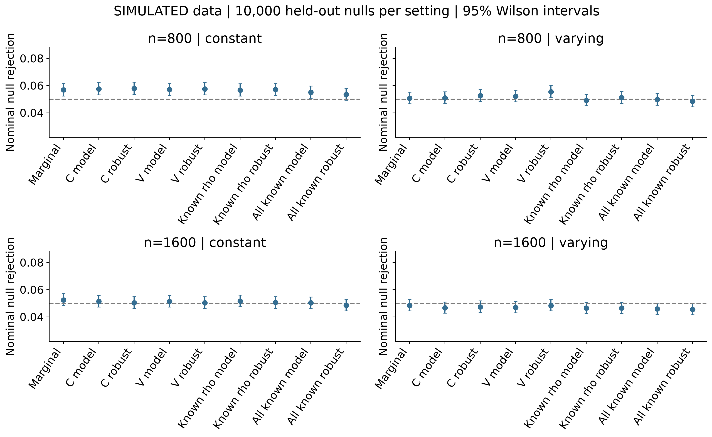
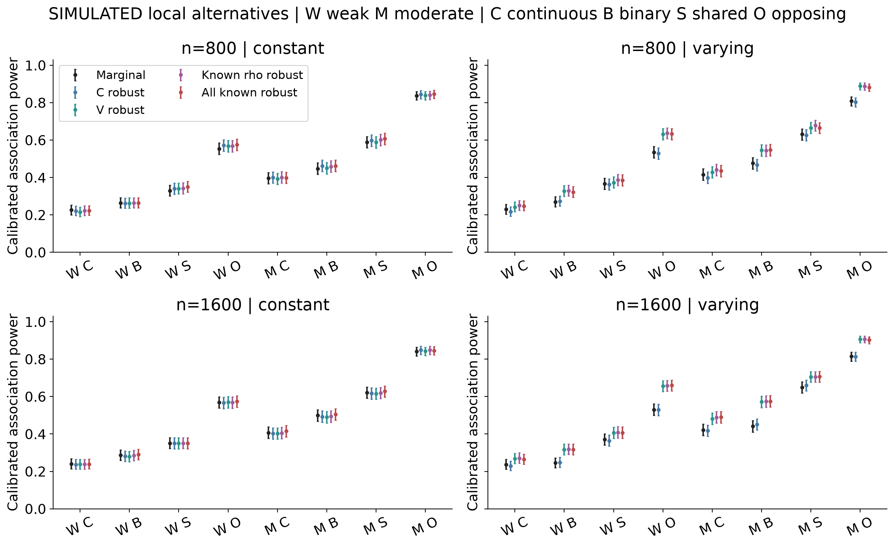
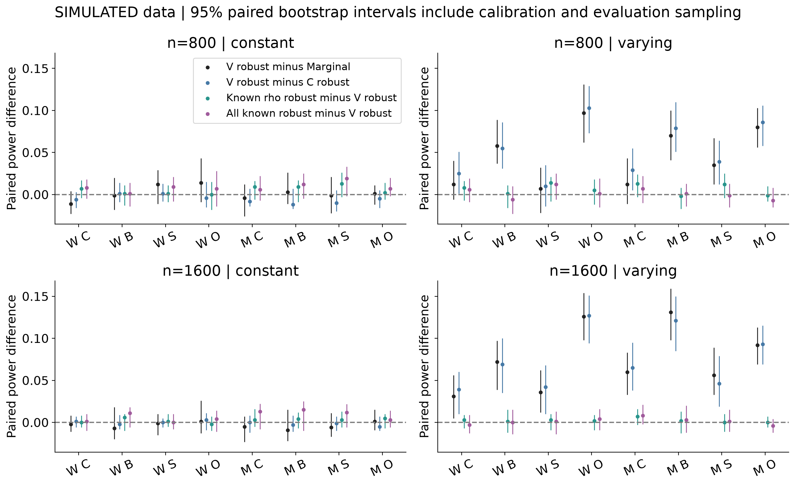
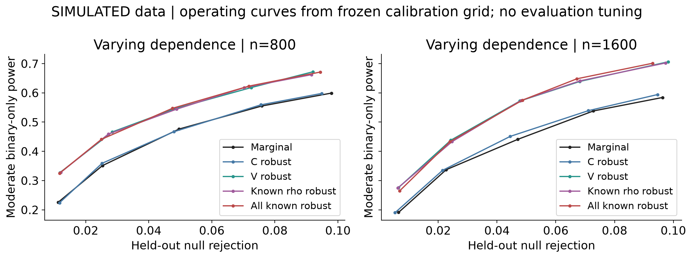
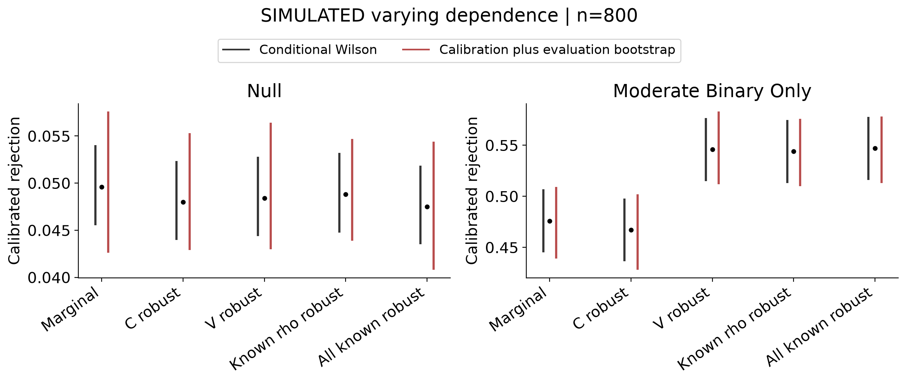
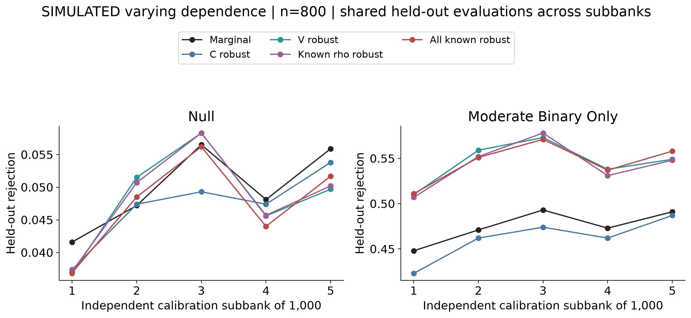
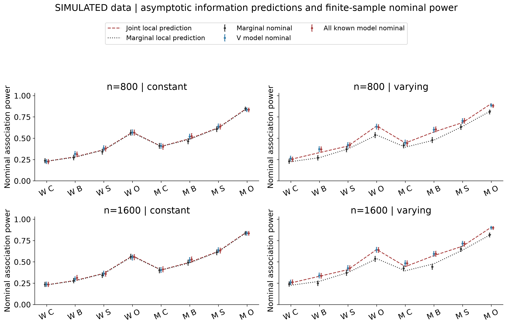

# Oracle benchmarks and calibration for joint copula genetic association

**Vusumuzi Mabasa**

**Simulation study.** All phenotypes, covariates and genotypes are synthetic. The continuous outcome is cardiometabolic-like and the binary outcome is mental-health-like; neither is an observed clinical measurement or diagnosis. No patient data, AWI-Gen data or Genomic SEM analyses are used.

[Word manuscript](report/CardioMental_Copula_GWAS_Report_v2.docx) | [Original study and complete archive](baseline/README.md) | [Second benchmark protocol](v2/protocol/design.json) | [Full statistical estimates](v2/results/summary.csv) | [Audited results](v2/results/audit.json) | [Full workflow](workflow.txt)

<!-- manuscript -->

## Abstract

**Background.** A more accurate phenotype-dependence model need not improve joint genetic association testing. The original simulation was limited by strong alternatives and small calibration banks. This second experiment examines whether dependence estimation conceals an attainable efficiency gain and whether conclusions persist with weaker signals and more precise calibration.

**Methods.** A separate pilot selected two local-alternative strengths using a prespecified marginal comparator. Four Gaussian settings crossed sample sizes 800 and 1,600 with constant or age-varying dependence. Nine procedures included covariance-aware marginal testing, fitted constant and varying copulas, an oracle with known dependence and fitted margins, and a fully known null-nuisance oracle. Each setting used 5,000 calibration null datasets, 10,000 fresh evaluation nulls and 1,000 datasets for each of eight alternatives. Independent R calculations checked the oracle likelihood and scores.

**Results.** The 92,000 datasets produced 828,000 method records with 0 recorded failures. At n=800 with varying dependence, calibrated moderate binary-only power was 0.546 for varying-sandwich testing and 0.476 for marginal testing. The known-dependence-sandwich minus varying-sandwich difference was -0.002 (calibration-aware 95% bootstrap interval -0.017 to 0.008).

**Conclusion.** Power gains occurred in several varying-dependence alternatives, while differences under constant dependence were small. The small known-dependence oracle gaps were consistent with expected score orthogonality. The evidence supports a conditional benefit of joint dependence modelling within this synthetic Gaussian design.

## Introduction

Joint analysis of a continuous cardiometabolic measurement and a binary mental-health outcome can use their conditional dependence while retaining distinct genetic effects. Copula regression for mixed outcomes is established [1]; a more flexible dependence function is therefore a modelling choice whose statistical value must be demonstrated, rather than assumed from improved fit alone.

The original benchmark retained 13,120 synthetic datasets and found similar calibrated performance for several practical methods. Most shared and opposing alternatives had power near one. Its 200-null calibration banks also introduced appreciable threshold uncertainty. Those results remain unchanged in the version-one archive and original result directories. They motivate a fresh experiment, rather than retrospective modification of the first protocol.

The present questions are whether dependence estimation materially reduces association power, whether a simpler covariance-aware test already captures much of the useful information, and how calibration uncertainty changes the interpretation of small differences. The design follows explicit aims, generating mechanisms, estimands, methods and performance measures [2]. It does not claim a new general copula framework or demonstrate a clinical relationship between diseases.

## Methods

### Experimental design and signal selection

An independent 640-dataset pilot crossed constant and varying dependence, four effect scales and four signal architectures at n=800. Twenty datasets supported each pilot cell. The two distinct scales minimised squared distance between pooled covariance-aware marginal nominal power and targets 0.30 and 0.65, with a fixed lexicographic tie rule. Only that marginal comparator selected the scales; oracle and varying-model performance did not influence selection. The chosen scales were 0.4 and 0.55, with pilot pooled marginal rejection 0.406 and 0.594. Pilot observations are excluded from main estimates and uncertainty intervals.

For each sample size, let the architecture vector b be (0.20,0), (0,0.35), (0.20,0.35) or (0.20,-0.35). Two strengths use

$$\boldsymbol\beta_n=c\sqrt{800/n}\,\mathbf b.$$

Thus the generating continuous and binary effects at n=800 are 0.080 and 0.140 for the weaker strength and 0.110 and 0.1925 for the moderate strength, when that component is active. At n=1,600 both components are divided by the square root of two. This local-alternative design studies estimation behaviour at approximately comparable information across sample sizes; it is not a fixed-effect sample-size power curve. Pilot labels do not guarantee every architecture has intermediate power.

Four main settings cross n=800 or 1,600 with constant or varying Gaussian dependence. Each uses 5,000 calibration nulls, 10,000 evaluation nulls and eight sets of 1,000 alternatives, giving 23,000 datasets per setting. Source and protocol were frozen in commit [a419d2c](https://github.com/Vusumuzi2Mabasa/CardioMental-Copula-GWAS/commit/a419d2cc98f69df2105d75c74979b5b90f94824f) before the main simulation. Pilot, calibration and evaluation seeds are 29102001, 29102011 and 29102012, respectively.

### Synthetic phenotypes and genetic association target

The covariate vector contains an intercept, a standard-normal age-like draw clipped at -2.5 and 2.5, and a centred Bernoulli exposure with probability 0.5. The focal genotype is Binomial(2,0.25), independent of these covariates. People are independent. For centred genotype g=G-0.5,

$$Y_i=0.35a_i+0.25e_i+\beta_1g_i+Z_{1i},$$
$$D_i=I\{b_0+0.25a_i+0.40e_i+\beta_2g_i+Z_{2i}>0\}.$$

The residuals have unit normal margins and Gaussian dependence. Their correlation is either 0.4 or

$$\rho_i=\tanh\{\operatorname{atanh}(0.3)+0.6a_i\}.$$

The intercept b0 is determined by independent population quadrature to give null binary prevalence 0.15. It remains fixed across alternatives, so alternative prevalence may change. This differs from version one, which recalibrated prevalence under each binary effect; results from the two studies are not pooled as a single experiment. Binary effects are probit-liability coefficients, not log odds ratios.

The focal null is

$$H_0:\beta_1=\beta_2=0.$$

Rejection indicates association with at least one phenotype. It does not establish effects on both, shared causality, fine-mapping or a causal disease relationship. The experiment tests one focal SNP per dataset and is not an executed genome-wide scan.

### Mixed outcome likelihood and score tests

Let mu be the continuous mean, eta the binary probit predictor, sigma the continuous residual standard deviation, z=(y-mu)/sigma and t=2d-1. The per-person log likelihood is

$$\ell_i=-\log\sigma-\tfrac12 z_i^2-\tfrac12\log(2\pi)+\log\Phi\left\{\frac{t_i(\eta_i+\rho_i z_i)}{\sqrt{1-\rho_i^2}}\right\}.$$

This expression uses the binary probability conditional on the continuous outcome, rather than a continuous copula density evaluated at a binary observation. Analytic individual scores and stable normal-tail calculations are reused unchanged from the validated original engine. Fitted marginal and copula models use bounded L-BFGS-B with gradient and information checks.

Let U denote the summed score, H the negative observed Hessian and nu the unknown nuisance parameters. With beta denoting the two genetic coefficients,

$$A=H_{\beta\nu}H_{\nu\nu}^{-1},\quad U_{\mathrm{eff}}=U_\beta-AU_\nu,$$
$$H_{\mathrm{eff}}=H_{\beta\beta}-AH_{\nu\beta},\quad T_{\mathrm{model}}=U_{\mathrm{eff}}^{\mathsf{T}}H_{\mathrm{eff}}^{-1}U_{\mathrm{eff}}.$$

For individual adjusted scores psi,

$$\psi_i=s_{\beta i}-As_{\nu i},\quad V=\sum_i\psi_i\psi_i^{\mathsf{T}},\quad T_{\mathrm{robust}}=U_{\mathrm{eff}}^{\mathsf{T}}V^{-1}U_{\mathrm{eff}}.$$

Two-degree-of-freedom chi-square references require regularity and full-rank positive information. The robust label denotes sandwich variance construction; it does not guarantee unbiased estimating equations or validity under arbitrary misspecification.

### Practical comparators and oracle definitions

The five practical procedures are a covariance-aware marginal score test, constant-copula model and sandwich tests, and varying-copula model and sandwich tests. The marginal procedure fits the two margins under independence and retains cross-outcome score covariance. All practical methods receive only observable synthetic data.

The known-dependence oracle fixes the generating dependence coefficients and estimates the seven marginal nuisance parameters: three continuous coefficients, three probit coefficients and log sigma. Known dependence coefficients are removed from the nuisance projection and from numerical differentiation. Merely inserting the generating rho into the original nine-nuisance test would answer a different question.

The fully known oracle fixes all generating null nuisance parameters and therefore uses no nuisance projection. Its genotype is centred at the known population mean 0.5, whereas procedures with fitted intercepts use sample centring as in the original engine. Both oracles have model-information and sandwich variants, bringing the total to nine tests. Their generating information is unavailable in an ordinary study. They are diagnostic benchmarks, not deployable methods or guaranteed finite-sample power upper bounds.

### Expected orthogonality in this design

Under the null, the population-centred genotype is independent of the covariates and outcomes and has mean zero. Write the genetic score as g times a two-component marginal-predictor score b, while the nuisance score depends only on the covariates and outcomes. Then

$$E(s_{\beta i}s_{\nu i}^{\mathsf T})=E(g_i)E(\mathbf b_i s_{\nu i}^{\mathsf T})=0.$$

For a correctly specified regular model this gives zero expected cross-information. Consequently, estimating nuisance parameters need not produce a first-order asymptotic efficiency loss for the genetic coefficients in this particular prospective independent-genotype design. Oracle comparisons primarily diagnose finite-sample estimation, observed-information and calibration effects. This argument does not equate a misspecified constant copula with the correct varying copula, nor establish orthogonality under population structure, non-centred conditional genotypes or other sampling schemes.

### Analytical information benchmark

A supplementary analytical diagnostic was added after freezing the main simulation protocol and before examining alternative evaluation results. It did not alter the signals, methods, thresholds or replicate counts. Gaussian quadrature integrates null information over the covariates, continuous residual and binary outcome. Let q=2f(1-f) with allele frequency f=0.25, and let w be the marginal probit information weight:

$$w_i=\frac{\phi(\eta_i)^2}{\Phi(\eta_i)\{1-\Phi(\eta_i)\}},\quad J=q\,\operatorname{diag}\{1,E(w_i)\}.$$
$$V_m=q\begin{pmatrix}1&E(\rho_i w_i)\\E(\rho_i w_i)&E(w_i)\end{pmatrix},\quad I_m=J^{\mathsf T}V_m^{-1}J.$$

Here Im is the Godambe information of the stacked marginal scores. The correct joint likelihood gives Ic=q E(Hbase), where Hbase is the observed information for the continuous-mean and probit-predictor pair. Expected orthogonality permits this comparison without a first-order nuisance penalty. For the local effect delta=sqrt(n) beta, the two analytical predictions use

$$\lambda_k=\boldsymbol\delta^{\mathsf T}I_k\boldsymbol\delta,\quad \pi_k=\Pr\{\chi^2_2(\lambda_k)>\chi^2_{2,0.95}\}.$$

These are asymptotic nominal-power approximations, not calibrated finite-sample results. Eighty-node quadrature checks the information identity, zero mean scores, independence equality and the nonnegative information difference. Increasing residual quadrature to 120 nodes checks numerical integration separately from the non-smooth age clipping; age-order sensitivity is retained in the controls. Independent R quadrature and finite-difference likelihood Hessians provide an additional validation, with maximum information discrepancy 3.84e-10.

### Calibration and uncertainty

All calibration datasets are generated before evaluation begins. For a target alpha, let k=floor{alpha(Bcal+1)} with Bcal=5,000. Each method and setting freezes the kth ordered calibration p-value q. Evaluation rejects strictly when p is below q. Under exchangeability and continuous p-values, rejection averaged across calibration banks targets k/(Bcal+1); conditional size with a particular bank can differ. The primary alpha is 0.05, and an independently frozen grid at 0.01, 0.025, 0.05, 0.075 and 0.10 supports operating curves. Evaluation nulls do not select thresholds or tune methods.

Nominal rejection and empirical rejection are reported separately. Conditional rates use Wilson intervals. For rejection indicators R and B evaluation datasets,

$$\widehat{\operatorname{MCSE}}(\hat p)=\sqrt{\hat p(1-\hat p)/B}.$$

Paired contrasts use the mean within-dataset difference and its sample standard deviation divided by the square root of B. To include calibration uncertainty approximately, 400 nonparametric bootstrap replicates resample calibration datasets jointly across all methods, reconstruct cutoffs, and independently resample evaluation datasets jointly across methods. Percentile intervals therefore retain paired comparisons while allowing both sources of sampling variation. They are simulation uncertainty intervals, not clinical confidence intervals or multiplicity-adjusted superiority tests.

Five disjoint calibration subbanks of 1,000 datasets additionally illustrate smaller-bank variation. Their held-out evaluations are shared, so the five resulting rejection rates are correlated. This diagnostic does not estimate variability across independent 5,000-null banks. Bootstrap results remain approximate, particularly for tail cutoffs; neither procedure validates p-values at 5e-8.

### Validation and failure accounting

Oracle scores were checked against an independently assembled expanded Hessian, allele recoding and the independence limit. A separate base-R implementation used the explicit likelihood, BFGS, finite differences and an expanded numerical Hessian. The expanded-Hessian maximum statistic discrepancy was 2.22e-12; the independent R maximum p-value discrepancy was 3.23e-09, and its restricted-fit parameter discrepancy was 5.24e-07.

Every planned dataset and method record remains in the output with its final fitting status. Failures count as non-rejections with attempted and valid denominators reported separately; any failed calibration fit disables its method's empirical cutoff. Interrupted incomplete chunks are regenerated from the same seeds; counts refer to unique planned datasets, rather than computational retries. Chunk hashes, frozen source hashes and dataset fingerprints support resumable computation. A final audit verifies thresholds, checks all checkpoint hashes and regenerates the first dataset of every calibration and evaluation stream. A separate summary audit reconstructs reported decisions, checks Wilson intervals against SciPy, verifies every saved bootstrap quantile and replays selected bootstrap draws. The original engine, protocol, results and figures are checked byte-for-byte against the preserved version-one snapshot.

## Results

### Numerical validation and complete accounting

The main benchmark retained 92,000 datasets, comprising 20,000 calibration nulls, 40,000 held-out nulls and 32,000 alternatives. Nine methods produced 828,000 records. There were 0 recorded failures. All 40 replayed datasets reproduced their fingerprints and score p-values within the audit tolerance. The separate 640-dataset pilot is not included in these counts. Numerical agreement establishes implementation consistency; operating characteristics must be assessed from held-out results.

### Null calibration

At n=800 with varying dependence, varying-sandwich nominal null rejection was 0.055, and its independently calibrated rejection was 0.048. The corresponding frozen p-value cutoff was 0.0433. The held-out sample measures realised size; calibration does not force this sample to reject exactly 5%.

| People | Dependence | Marginal | Constant robust | Varying robust | Known rho robust | All known robust |
| --- | --- | --- | --- | --- | --- | --- |
| 800 | constant | 0.057 | 0.058 | 0.058 | 0.057 | 0.053 |
| 800 | varying | 0.051 | 0.053 | 0.055 | 0.051 | 0.048 |
| 1600 | constant | 0.052 | 0.050 | 0.050 | 0.051 | 0.049 |
| 1600 | varying | 0.048 | 0.047 | 0.048 | 0.046 | 0.045 |

Table 1. Nominal focal-SNP null rejection at alpha 0.05, based on 10,000 held-out nulls per setting. Robust denotes nuisance-adjusted sandwich variance. Model-based variants are retained in the complete result CSV and figure.

The figure shows nominal size and Wilson uncertainty for all nine methods. Differences from 0.05 should be interpreted with the 10,000-dataset precision rather than visually treating every deviation as evidence of invalidity.



Figure 1. Simulated nominal null rejection with 95% Wilson intervals. The dashed reference is 0.05. All known and known rho denote oracle information.

### Association power below the ceiling

At n=800 under varying dependence, moderate binary-only power was 0.546 for varying-sandwich testing, 0.467 for constant-sandwich testing and 0.476 for covariance-aware marginal testing. The varying-minus-marginal difference was 0.070, with calibration-aware 95% bootstrap interval 0.041 to 0.100. This is a paired operating-point comparison, not a multiplicity-adjusted superiority finding. Across the displayed practical and robust-oracle alternatives, calibrated power ranged from 0.215 to 0.907. Stronger shared or opposing architectures can still be easier to detect; selected pilot scales do not impose equal power across architectures.

| Signal architecture | Marginal | Constant robust | Varying robust | Known rho robust | All known robust |
| --- | --- | --- | --- | --- | --- |
| weak continuous only | 0.230 | 0.217 | 0.242 | 0.250 | 0.248 |
| weak binary only | 0.270 | 0.273 | 0.328 | 0.329 | 0.322 |
| weak shared | 0.366 | 0.363 | 0.373 | 0.387 | 0.385 |
| weak opposing | 0.535 | 0.529 | 0.632 | 0.637 | 0.633 |
| moderate continuous only | 0.416 | 0.399 | 0.428 | 0.441 | 0.435 |
| moderate binary only | 0.476 | 0.467 | 0.546 | 0.544 | 0.547 |
| moderate shared | 0.631 | 0.627 | 0.666 | 0.678 | 0.665 |
| moderate opposing | 0.809 | 0.803 | 0.889 | 0.888 | 0.882 |

Table 2. Calibrated focal-SNP power at n=800 with varying dependence, based on 1,000 fresh datasets per alternative. The summary CSV contains nominal power, valid denominators, conditional uncertainty, all nine methods and both sample sizes.

The local-alternative comparison keeps effect magnitudes smaller at n=1,600, so between-sample-size differences reflect both finite-sample estimation and the specified scaling. The figure should not be interpreted as the benefit of increasing sample size while keeping effects fixed.



Figure 2. Calibrated power with 95% conditional Wilson intervals. W and M indicate weaker and moderate strengths; C, B, S and O indicate continuous-only, binary-only, shared and opposing effects. Intervals condition on the frozen 5,000-null calibration banks.

### Oracle gaps and estimation cost

The known-dependence-sandwich minus varying-sandwich point difference for moderate binary-only power at n=800 with varying dependence was -0.002 (-0.017 to 0.008). The interval includes zero and does not resolve a power gain from knowing dependence. This is not proof of equivalence or a guaranteed oracle ordering. The fully known oracle additionally removes marginal nuisance estimation and changes genotype centring to its known population mean; its contrast therefore cannot be attributed solely to learning rho.

| People | Contrast | Power difference | 95% bootstrap interval |
| --- | --- | --- | --- |
| 800 | Varying minus marginal | 0.070 | 0.041 to 0.100 |
| 800 | Varying minus constant | 0.079 | 0.051 to 0.110 |
| 800 | Known rho minus varying | -0.002 | -0.017 to 0.008 |
| 800 | All known minus varying | 0.001 | -0.014 to 0.013 |
| 1600 | Varying minus marginal | 0.131 | 0.098 to 0.159 |
| 1600 | Varying minus constant | 0.121 | 0.085 to 0.150 |
| 1600 | Known rho minus varying | 0.002 | -0.013 to 0.013 |
| 1600 | All known minus varying | 0.003 | -0.012 to 0.020 |

Table 3. Paired calibrated-power differences for moderate binary-only alternatives under varying dependence. The 95% percentile intervals resample both calibration and evaluation datasets; 400 bootstrap replicates support each interval. These descriptive contrasts are not corrected for multiple comparisons.

The full pattern across signal directions is more informative than a single favourable contrast. Intervals overlapping zero indicate that this experiment does not resolve the sign of the difference at that precision; they do not establish equivalence.



Figure 3. Paired power differences with approximate 95% bootstrap intervals including calibration and evaluation sampling. Oracle superiority is not imposed by construction.

### Calibration uncertainty and operating curves

Frozen thresholds produce different realised false-positive rates in the independent evaluation sample. The following table makes those operating points explicit for varying dependence at n=800.

| Method | Nominal null | Calibrated null | Null cutoff |
| --- | --- | --- | --- |
| Marginal | 0.051 | 0.050 | 0.0491 |
| Constant robust | 0.053 | 0.048 | 0.0455 |
| Varying robust | 0.055 | 0.048 | 0.0433 |
| Known rho robust | 0.051 | 0.049 | 0.0474 |
| All known robust | 0.048 | 0.048 | 0.0488 |

Table 4. Nominal rejection, independently calibrated rejection and frozen p-value cutoffs. All rates use the same 10,000 held-out null datasets within the setting.

The operating curves connect the five prespecified calibration targets and display their held-out null rejection on the horizontal axis. They permit a broader assessment of power and size without selecting an evaluation-derived threshold. The curves do not demonstrate equality of the true false-positive rates at every plotted point.



Figure 4. Moderate binary-only power versus held-out null rejection under varying dependence. Each point corresponds to an independently frozen calibration-grid cutoff. The grid was not tuned on these evaluations.

For varying-sandwich moderate binary-only power at n=800, the conditional Wilson interval was 0.515 to 0.577, while the calibration-plus-evaluation bootstrap interval was 0.512 to 0.583. The intervals answer different uncertainty questions; their widths need not be ordered in every realised sample.



Figure 5. Conditional Wilson intervals and approximate calibration-plus-evaluation bootstrap intervals at n=800 with varying dependence. Both refer to independently calibrated rejection at target 0.05.

Across the five 1,000-null subbanks, the varying-sandwich held-out null rejection at n=800 ranged from 0.037 to 0.058. These observations demonstrate sensitivity to a smaller empirical calibration bank while retaining exactly the same evaluation data.



Figure 6. Independent calibration subbanks of 1,000 null datasets, applied to shared held-out evaluation datasets. Main reported results use the full 5,000-null banks, not an average of these five rates.

### Analytical predictions and observed power

The information calculation predicts only small differences from covariance-aware marginal testing under constant dependence. Under varying dependence, the moderate binary-only local-power predictions are 0.575 for the correct joint model and 0.479 for the marginal procedure, with noncentrality ratio 1.248. These predictions indicate that the specified varying-dependence setting contains a potentially useful information gain even when knowing nuisance parameters provides little first-order benefit.

| Architecture | Information ratio | Joint prediction | Marginal prediction | V model nominal | All known model nominal |
| --- | --- | --- | --- | --- | --- |
| weak continuous only | 1.142 | 0.253 | 0.226 | 0.266 | 0.253 |
| weak binary only | 1.248 | 0.332 | 0.273 | 0.374 | 0.371 |
| weak shared | 1.102 | 0.410 | 0.376 | 0.421 | 0.419 |
| weak opposing | 1.266 | 0.646 | 0.538 | 0.638 | 0.632 |
| moderate continuous only | 1.142 | 0.445 | 0.396 | 0.450 | 0.443 |
| moderate binary only | 1.248 | 0.575 | 0.479 | 0.601 | 0.607 |
| moderate shared | 1.102 | 0.685 | 0.639 | 0.705 | 0.707 |
| moderate opposing | 1.266 | 0.907 | 0.825 | 0.890 | 0.882 |

Table 5. Analytical local-power predictions under varying dependence, compared with finite-sample nominal rejection at n=800. Information ratio is joint divided by marginal noncentrality. The prediction is asymptotic and common to both sample sizes under the specified local scaling; observed rates use 1,000 alternatives each. This table uses nominal, rather than empirically calibrated, power to align with the analytical chi-square reference.

The figure checks whether nominal finite-sample behaviour approaches the analytical predictions across sample sizes and effect directions. Differences can arise from finite-sample estimation, the local approximation and realised nominal size. The prediction does not replace independent null calibration or justify a universal power claim.



Figure 7. Analytical local-power predictions and observed nominal rejection with 95% Wilson intervals. Joint predictions correspond to the correct Gaussian dependence model; both oracle and fitted varying-model nominal rates are displayed. The analytical diagnostic did not select or tune the main experiment.

## Discussion

This second experiment makes the comparison more informative by reducing ceiling effects, increasing calibration precision and defining oracle procedures that remove specific nuisance-estimation burdens. The observed pattern supports a conditional benefit: several varying-dependence alternatives favour the correctly specified joint approach, whereas constant-dependence differences are small. Oracle and fitted varying tests have close point estimates in these settings. A fitted dependence curve and a useful association test remain different objectives, but the current experiment identifies circumstances in which their gains align.

The known-dependence contrast isolates the effect of estimating dependence coefficients within the specified Gaussian model, including finite-sample differences in observed information and empirical thresholds. Small or unresolved gaps imply little demonstrated practical gain from eliminating that estimation burden in the studied setting. Larger gaps would identify a reason to investigate more efficient or regularised dependence estimation, but would not alone establish a generally superior test.

The expected-score orthogonality derived above gives an additional reason not to anticipate a large oracle advantage here: estimating more nuisance coefficients is not automatically a first-order information penalty for the genetic score. Thus a small oracle gap would be compatible with the design's mathematics, rather than evidence that the oracle was implemented unsuccessfully. To distinguish practical dependence models, the relevant information gain can instead depend on how each method weights observations and genetic-effect directions.

The analytical information calculation makes that distinction concrete: the theoretical gain over marginal testing is small with the specified constant correlation and larger for several directions under age-varying correlation. A small oracle-versus-fitted gap can therefore coexist with a meaningful joint-versus-marginal gain. The observed results must still be assessed with their uncertainty and null behaviour before translating that conditional pattern into a methodological conclusion.

Covariance-aware marginal testing remains a demanding comparator because it uses cross-outcome score covariance without requiring a fully correct joint distribution. Adding dependence parameters can improve the joint likelihood while contributing little additional information for a particular genetic-effect direction. Conversely, favourable copula contrasts should be evaluated against their realised null rejection and calibration-aware uncertainty before being interpreted as efficiency gains.

The oracle methods deliberately receive unavailable generating information. Their performance is diagnostic and should not be presented as an achievable analysis of patient data. Correct-model information may motivate asymptotic efficiency arguments, but observed finite-sample power need not follow a universal oracle ordering, especially after separate empirical calibration.

The original negative findings remain preserved rather than replaced. The new local alternatives and fixed null intercept define a distinct experiment, so differences from version one are not evidence that a single isolated change caused an improvement. The present work still does not benchmark an external published copula package. Region-level CBMAT [3] requires a separate genetic architecture and aligned region-level null before a fair direct comparison.

## Limitations

The main extension intentionally concentrates on correctly specified Gaussian models, one common focal SNP and independent people. It does not introduce empirical LD references, polygenic background, relatedness, ancestry effects, missing phenotypes, ascertainment or diagnosis misclassification. The original t-copula sensitivity remains available in version one; it was not expanded here. Results cannot establish robustness to those omitted conditions. Analytical information predictions depend on the same correct model and use a local asymptotic approximation; they are not independent evidence of real-world validity.

Five thousand calibration nulls improve central-tail precision but do not validate genome-wide significance. Four hundred bootstrap replicates provide approximate simulation intervals rather than precise extreme quantiles. Calibration subbanks are smaller than the main banks and share evaluations. Only four core settings and two pilot-selected local strengths were tested; power can remain high for some architectures. Effect-estimation and interval-coverage analyses from version one remain available, but new full-effect estimation was not added to this score-comparison stage.

No clinical data are analysed. A phenotype-dependence parameter cannot separate background genetic correlation from environmental comorbidity without explicit additional structure. This study makes no causal claim, no claim of novel copula regression and no assertion of submission readiness.

## Conclusion

The revised simulation identifies power gains under several age-varying dependence alternatives, small practical differences under constant dependence and little resolved gain from supplying the true dependence coefficients. These findings are consistent with the analytical information comparison and expected score orthogonality. They support a conditional advantage for modelling heterogeneous dependence within the specified Gaussian design, rather than a generally superior GWAS procedure. Further evaluation should introduce separately prespecified misspecification and genetic-background scenarios.

## Reproducibility

All new scientific outputs are under v2. The original source, protocol, cells, figures and original Word report retain their original bytes; a complete version-one snapshot is linked above. Python runs the simulations, and R supplies independent numerical validation. The full experiment ran natively on Windows, with project files on the Toshiba drive. Calibration began with three workers, then resumed with two to reduce memory pressure, retaining verified completed chunks and unchanged sources and design. Independent [Linux numerical and smoke checks](https://github.com/Vusumuzi2Mabasa/CardioMental-Copula-GWAS/actions/runs/40779093512) passed on GitHub's Ubuntu runner at commit f066cbc, including the independent R likelihood and expected-information checks. The full 92,000-dataset experiment was not repeated on Linux.

From the repository root, after creating an isolated Python environment and installing requirements.txt and R jsonlite:

```bash
python v2/src/test_oracle.py
Rscript --vanilla v2/src/crosscheck.R v2
# Published pilot outputs and their source lock are already frozen.
# Run a new pilot only in a separate checkout with a new versioned design.
python v2/src/freeze.py
python v2/src/run.py --smoke --workers 2
python v2/src/run.py --workers 2
python v2/src/information.py
Rscript --vanilla v2/src/information_check.R v2
python v2/src/audit.py
python v2/src/analyse.py
python v2/src/summary_audit.py
python v2/src/manuscript.py
python v2/src/build_word.py --pandoc /path/to/pandoc
```

Completed chunks resume only when source and output hashes agree. To perform a genuinely fresh main simulation, archive the whole v2/results/chunks directory and its thresholds.json together outside the checkout before rerunning. Do not mix chunks, sources or thresholds across protocols. Existing publication checksums authenticate the delivered snapshot; rerunning computations changes timing and Word metadata, so a new publication requires a new manifest and rendered-page review. The audit verifies statistical reproducibility through seeds and numerical agreement rather than identical elapsed times.

Pandoc distributed with Quarto converts this shared manuscript to Word with native editable equations, the author name and interpretations before figures. Word pagination and all figure/table placements are checked visually after rendering. The original analysis commands belong to the preserved version-one archive; the current workflow.txt describes this second experiment.

## References

1. de Leon AR, Wu B. Copula-based regression models for a bivariate mixed discrete and continuous outcome. Statistics in Medicine 30, 175–185 (2011). [doi:10.1002/sim.4087](https://doi.org/10.1002/sim.4087).
2. Morris TP, White IR, Crowther MJ. Using simulation studies to evaluate statistical methods. Statistics in Medicine 38, 2074–2102 (2019). [doi:10.1002/sim.8086](https://doi.org/10.1002/sim.8086).
3. St-Pierre J, Oualkacha K. A copula-based set-variant association test for bivariate continuous, binary or mixed phenotypes. International Journal of Biostatistics 19, 369–387 (2023; online 2022). [doi:10.1515/ijb-2022-0010](https://doi.org/10.1515/ijb-2022-0010).
