# Shared genetic associations causal variants and polygenic architecture in simulated cardiometabolic and mental health traits

**Vusumuzi Mabasa**

**Simulation study.** Every phenotype, disease indicator and genetic effect is simulated. Public 1000 Genomes haplotypes supply local LD only. This work contains no patient discoveries, AWI-Gen analysis or claim that shared genetic causes have been established in a real population.

[Word manuscript](report/CardioMental_Shared_Genetics_Report_v4.docx) · [Previous oracle study](https://github.com/Vusumuzi2Mabasa/CardioMental-Copula-GWAS/blob/a648ebd/README.md) · [Frozen version three protocol](v3/protocol/design.json) · [Local results](v3/results/aggregate_rates.csv) · [Fine mapping](v4/results/finemap_matched_comparison.csv) · [Polygenic validation](v4/results/polygenic_validation/polygenic_aggregate.csv)

<!-- manuscript -->
## Abstract

Shared genetic association, one shared causal variant and genome-scale genetic correlation are distinct inferential targets. We evaluated all three in synthetic cardiometabolic and mental-health data using public African haplotypes. The local experiment generated 31,200 datasets using Yoruba and Luhya LD, trait-specific and shared effects, distinct variants in LD and realistic phenotype perturbations. A fixed 3,120-dataset subset supported 6,240 ancestry-aware multi-signal fine-mapping and colocalisation analyses. A separate polygenic model used 22 independent synthetic LD blocks and bivariate relationship-kernel REML. Its initial 4,000-cohort experiment was retained, followed by 8,000 new calibration cohorts and 4,800 fresh evaluation cohorts. Across both experiments, 48,000 synthetic cohorts were generated; outcome modes and reused fine-mapping subsets are not additional independent cohorts. In fresh binary-outcome validation at n=1,200, mean estimated genetic correlation was 0.502 for truth 0.5 and -0.512 for truth -0.5; calibrated rejection under zero genetic covariance was 3.9%. Local LD included configurations in which shared and distinct causal variants were observationally indistinguishable. The results provide methodological evidence for separating the three targets and for testing genetic correlation while allowing residual dependence. All clinical phenotypes and genetic effects are simulated; no shared genetic cause of real cardiometabolic and mental disorders is established.

## Introduction

The co-occurrence of cardiometabolic disease and mental ill-health motivates genetic studies of multimorbidity. A common phenotype correlation can nevertheless arise without any variant affecting both traits. Conversely, one causal variant may affect both phenotypes even when their total correlation is modest or their effects have opposing directions. Association with two diseases, colocalisation of genetic signals and a causal effect of one disease on another are therefore separate questions.

This distinction is relevant to research on shared cardiometabolic and mood-disorder genetics in African populations, including the programme described in the Wits announcement of Dr Vivien Chebii's Wellcome award [1]. The present independent simulation is thematically aligned with that question; it is not part of that grant and does not use its data. The 1000 Genomes Project provides public population-specific haplotypes for investigating one component of the problem, local linkage disequilibrium [2,3]. YRI and LWK are two sampled populations and do not represent all African genomic diversity.

The preceding version of this repository tested Gaussian/probit copula association procedures with independent common markers. Its oracle experiment showed conditional gains from correctly modelling dependence, without a general advantage or a resolved benefit from knowing nuisance parameters. Those results are preserved. The current extension changes the scientific target: it evaluates evidence for shared causal variants when nearby distinct causes can produce apparently shared associations.

## Methods

### Study design and preservation

The design was frozen in local commit 5999591 before the main simulations. Two populations, three regions and two phenotype regimes define 12 strata. Each stratum contains 200 independent evaluation replicates for each of eight architectures, giving 19,200 evaluation datasets. Five no-sharing architectures each contribute 200 independent calibration datasets per stratum, giving 12,000 calibration datasets. Calibration and evaluation use separate seed namespaces, and cutoffs were saved before evaluation began. All 31,200 datasets are retained in the published record. The earlier 92,000-dataset oracle experiment and the initial study remain separate; their denominators are not pooled with this extension.

### African reference haplotypes and causal configurations

We verified the complete public 1000 Genomes Phase 3 v5b chromosome 22 VCF and population-panel files against their SHA256 checksums [2,3]. Within YRI and LWK, a seeded split reserved 40 donors for external reference characterization and used the remaining 68 YRI and 59 LWK donors for generating study haplotypes. Donor pools were disjoint. Public outputs omit donor identifiers but retain derived haplotypes, population labels, split-list digests, source URLs and file checksums. These derived public data remain attributable to the original resource; omitting identifiers is not a claim of anonymisation.

We retained PASS, completely phased, biallelic, non-palindromic SNPs with minor-allele frequency at least 0.10 in each population and donor pool. We selected 64 coordinate-ordered common markers per 100 kb region. Sampling two whole local haplotypes independently with replacement generates each synthetic individual's genotype vector:

$$
G_i=h_{a_i}+h_{b_i},\qquad a_i,b_i\sim\operatorname{Uniform}\{1,\ldots,H\}.
$$

This preserves empirical within-region haplotype dependence and finite-panel allele frequencies. It does not generate genome-wide ancestry, pedigrees, migration or new recombination within the window. Independently simulated participants can reuse the same finite set of haplotypes. Donors are reference material, not the 3,200 simulated participants.

External reference LD selected an anchor and a distinct high-LD variant with the largest reference r² below 0.98 and at least 0.50. A second distinct variant minimised reference r² with the anchor and had r² below 0.05. These choices used no phenotypes. Study-pool LD was reported separately and was not used to revise the causal pair after selection. In the third region, the chosen high-LD pairs were perfectly correlated in both study pools; this prespecified consequence of finite reference sampling was retained as an identifiability stress test.

The eight architectures are: no effects; a cardiometabolic effect only; a mental-health effect only; one concordantly shared cause; one oppositely directed shared cause; distinct low-LD causes; distinct high-LD causes; and a shared cause plus an additional distinct mental-health cause. Active continuous effects are 0.18 residual-scale units per ALT allele and active mental-health effects are 0.35 probit-liability units, with a negative mental-health effect for opposing sharing. The last architecture intentionally violates the single-causal assumption of standard coloc. Effects were fixed before the main results were examined.

The known generating genetic covariance between the continuous predictor and the mental-health liability predictor is

$$
\operatorname{Cov}(g^\mathsf{T}\beta_C,g^\mathsf{T}\beta_M)=\beta_C^\mathsf{T}\Sigma_G\beta_M,\qquad\Sigma_G=2\operatorname{Cov}(h).
$$

The same-variant diagonal contribution is the sum of beta Cj times beta Mj times Sigma Gjj; off-diagonal terms arise from LD between different causal variants. This analytic truth is reported separately from inferred sharing. It is covariance between genetic predictors before treatment, thresholding and misclassification, rather than genetic covariance of the observed diagnoses. A nonzero total genetic covariance does not require any directly shared causal variant.

### Phenotype generation

Let A denote standard-normal age clipped to ±2.5, S a centred Bernoulli sex indicator, E a standard-normal measured exposure, and g the genotype centred using the generating haplotype pool. The cardiometabolic predictor and mental-health liability are

$$
Y^*=0.25A+0.15S+0.20E+0.08A^2+g^\mathsf{T}\beta_C+\epsilon_C,
$$

$$
L=-1.15+0.20A+0.15S+0.20E+0.05A^2+g^\mathsf{T}\beta_M+\epsilon_M,\qquad D^*=\mathbf{1}(L>0).
$$

In the ideal regime, epsilon C is Z1 and epsilon M is rho Z1 plus sqrt(1-rho²) Z2, where independent Z1 and Z2 are standard normal and rho = 0.35. The liability intercept is fixed across architectures; it is not retuned to force equal prevalence under alternatives. Dependence can produce comorbidity even in the architecture with no genetic effects.

In the realistic regime, dependence varies with age, and the continuous residual includes heavy tails and asymmetry:

$$
\rho(A)=\tanh\{\operatorname{atanh}(0.30)+0.35A\}.
$$

$$
\epsilon_C=0.70Z_1+0.45T_5/\sqrt{5/3}+0.15(Z_1^2-1).
$$

Here T5 is an independent Student t variable. The mental-health residual remains rho(A) Z1 plus sqrt(1-rho(A)²) Z2. The function rho is the Z1 coupling parameter; after adding the other continuous residual terms it is not the Pearson correlation between the observed traits.

Treatment B has probability expit(-1.8 + 0.7Y* + 0.3A), and the measured cardiometabolic outcome is Y = Y* - 0.6B + 0.25 Z3. For presentation, pressure equals 120 + 12Y in illustrative mmHg; the GWAS uses Y. Treatment thus lowers the proxy pressure by 7.2 mmHg. It depends on the pressure predictor and age, not mental diagnosis, avoiding a medication pathway that would silently turn a mental-only genetic architecture into an effect on both outcomes. The binary observation has sensitivity 0.90 and specificity 0.98 for D*. A complete observation is unavailable with probability expit(-2.7 + 0.25A + 0.20E). Availability is missing at random conditional on fitted covariates. Complete-case analysis was used. These values are plausible stress-test choices, not estimates from a clinical cohort.

Descriptive comorbidity is the co-occurrence of observed D = 1 and proxy pressure at least 140. Its odds ratio uses a 0.5 cell correction. The genetic analysis retains continuous pressure; it does not test two clinical diagnoses or the comorbidity indicator directly.

### Marginal GWAS and joint association

Each retained marker was fitted separately using linear regression for Y and logistic regression for observed D, with intercept, A, S, E and A². Logistic effects are estimated log odds ratios; generating mental effects are probit-liability coefficients and are not numerically equated to them. A batched Newton algorithm maximised the logistic likelihood, with bounded step increments and an explicit convergence requirement. If s and H denote the score and information at an iterate,

$$
\theta_{t+1}=\theta_t+H_t^{-1}s_t.
$$

$$
\widehat{\operatorname{Var}}_{HC0}(\widehat\theta)=H^{-1}\left(\sum_i s_i s_i^\mathsf{T}\right)H^{-1}.
$$

Step damping is a solver device; it does not replace convergence checks. HC0 sandwich variances supply marginal Wald p-values. Cross-products of the two regression influence functions estimate cross-trait covariance. For the two estimated marker effects b and their joint sandwich covariance V, the omnibus statistic is

$$
T=b^\mathsf{T}V^{-1}b,\qquad p_{joint}=\Pr(\chi^2_2\ge T).
$$

Its null states that both marginal coefficients are zero. Rejection establishes association with at least one phenotype, and a Bonferroni correction across 64 markers gives a region-level joint association p-value. This does not test a shared causal variant.

### Explicit conjunction of genetic associations

For a marker j, the conjunction null states that at least one phenotype has no marginal association:

$$
H_{0,j}^{conj}:\{\beta_{C,j}=0\}\ \operatorname{or}\ \{\beta_{M,j}=0\},\qquad
p_{IUT,j}=\max(p_{C,j},p_{M,j}),\quad
p_{region}=\min\{1,64\min_j p_{IUT,j}\}.
$$

This intersection-union test requires evidence for both associations and does not require independence between their p-values. The Bonferroni correction controls marker search under the corresponding region-wide conjunction null when each marginal p-value is valid. Distinct causal variants in LD can make a tag genuinely associated with both phenotypes: a conjunction rejection in that architecture is therefore not a false marginal-association finding, but would be a false attribution if interpreted as one shared cause. We report this distinction rather than treating conjunction as proof of pleiotropy.

### Shared causal variant inference

We used the standard single-causal-variant coloc approximate Bayes factor framework [4,5]. The primary continuous GWAS uses the first half of complete participants and the binary GWAS uses the second half. The partition depends only on participant index. This removes cross-trait sampling-error dependence between the two primary summary datasets, while reducing effective sample size. It estimates sharing from separate subsamples of the same generating population, rather than an individual-level copula likelihood. A whole-sample overlapping analysis is a diagnostic sensitivity with both a sample-size advantage and possible correlated errors; their effects cannot be separated by that contrast.

For estimated marker effect b, variance V and prior effect variance W, the Wakefield log Bayes factor is

$$
\log BF=\tfrac12\{\log(1-r)+rz^2\},\qquad r=\frac{W}{V+W},\quad z=\frac{b}{\sqrt V}.
$$

We used model-based GWAS variances for standard ABFs, a continuous prior SD of 0.15 in the fitted outcome units and a logistic prior SD of 0.20 log-odds units. These prior scales differ from generating effect sizes. With per-marker BF vectors BC and BM, unnormalised hypothesis weights are

$$
w_0=1,\quad w_1=p_1\sum_j BC_j,\quad w_2=p_2\sum_j BM_j.
$$

$$
w_3=p_1p_2\sum_{j\ne k}BC_jBM_k,\quad w_4=p_{12}\sum_j BC_jBM_j.
$$

Normalising the five weights gives posterior probabilities for neither trait associated, cardiometabolic association only, mental association only, distinct causes, and one shared cause. The primary priors are p1 = p2 = 10^-4 and p12 = 10^-5, with p12 sensitivity at 10^-6 and 10^-4. PP4 > 0.8 is the conventional decision rule. These weights and posteriors were checked against the established R coloc package, version 5.2.3. Colocalisation is conditional on the candidate set, effect priors and single-causal model; it cannot establish a biological mechanism or the causal direction between diseases.

### Composite null calibration and uncertainty

The no-shared-cause calibration set comprises no effects, cardiometabolic only, mental health only, distinct low-LD causes and distinct high-LD causes. For each population, region and phenotype regime, we independently calibrated the split and overlapping PP4 scores. For 200 calibration replicates per architecture, the rank allowance is k = floor(0.05 × 201) = 10. For an upper-tail score Q, the cutoff is the largest 191st ascending score across the five no-sharing architectures:

$$
c=\max_{s\in\mathcal N}Q_{s,(191)},\qquad\text{declare sharing only if }Q>c.
$$

For each individual calibration architecture, exchangeability gives average rejection probability at most 10/201 with the strict order-statistic rule in the absence of ties; taking the maximum is conservative for all included architectures. This guarantee is averaged over calibration banks, not conditional on one realised bank, and applies only to the generating mechanisms included in calibration. PP4 is an evidence score in this frequentist calibration; the resulting threshold does not create a universal posterior probability of causation. A separately calibrated tagging test uses the smallest 10th ascending region p-value across the no-effect and trait-specific banks; distinct-cause scenarios are not its marginal-association null.

Per-cell rates include all 200 attempted evaluation datasets, with Wilson intervals. Aggregate rates weight the six population-region cells equally within each phenotype regime and architecture. Four hundred paired stratified bootstrap draws independently resample calibration and evaluation replicates, recompute all cutoffs and preserve method pairing. Reported aggregate percentile intervals include both sources of simulation uncertainty. An ordinary bootstrap degenerates if every evaluation decision is zero or one. For boundary entries, Table 6 instead displays a finite-evaluation binomial bound conditional on the realised cutoffs; this bound does not include uncertainty from unseen calibration-bank realisations. Raw bootstrap quantiles remain published and a zero-width bootstrap interval must not be interpreted as certainty about a population rate. Comparisons are descriptive and do not provide multiplicity-adjusted superiority claims. Any failed main fit is retained as a non-discovery; a failed calibration fit blocks cutoff generation.

### Copula diagnostics and validation

The original Gaussian/probit code is retained unchanged. The first 20 evaluation replicates in every stratum and architecture form a fixed 1,920-dataset diagnostic panel. We fitted varying dependence with intercept and age and evaluated the sandwich score at the genotype-selected anchor. Both marginal models use the same five covariates as the new GWAS layer. The Gaussian/probit likelihood is correctly motivated by the ideal data and is deliberately stressed by heavy tails, treatment and observed diagnostic error in the realistic regime. These nominal anchor tests have a different search burden from region-level tests; they are not used for a power ranking against the full-panel methods or for claims of shared causation.

Independent controls compare the batched logistic solver against a separate optimiser, validate OLS and HC0 calculations, flip allele coding, replay seeded datasets and demonstrate exact non-identifiability when causal genotype columns are equal. R lm and glm independently check full-panel estimates and variances in prespecified fixtures; R coloc checks posterior enumeration. The source identity, raw chunk hashes and original-result checksums are audited before publication.

### Multi signal fine mapping for Level 2

The additional Level 2 protocol was frozen in commit 85b0bc4, after the local experiment had begun and before its fine-mapping analyses. We reused the first 20 calibration and evaluation replicates in every local stratum and architecture. The subset contains 1,200 calibration and 1,920 evaluation datasets; two LD conditions produce 6,240 analysis records. These datasets are included in the local experiment's denominator and are not new independent replications. Conventional ABF and SuSiE comparisons use the same subset and the same 20-replicate calibration banks in the secondary matched-subset analysis.

We ran established R SuSiE and coloc.susie, with up to five single-effect components and 95% credible sets [6,7]. SuSiE represents the effect vector as a sum of sparse components, each assigning one effect to a candidate variant:

$$
\beta=\sum_{\ell=1}^{5}b_\ell,\qquad z\ \mathrel{\dot\sim}\ N(\sqrt{N}R\beta,R).
$$

The RSS normal approximation conditions on aligned signed LD and the standardised effect vector. In this expression beta denotes standardised effects, not the unscaled generating probit coefficients. It is an approximation for the binary logistic GWAS. Residual variance estimation was disabled, and retained fits had to converge within 1,000 iterations. Prior effect variance was estimated by the package. Credible sets required the package's default purity checks; absence of a retained signal is a valid no-discovery outcome. Variant posterior inclusion probabilities and all retained credible sets are published, including known simulated causal indices.

The primary external LD matrix uses the 40 ancestry-matched reference donors, paired as their observed diploid genotypes. The comparison uses LD from the actual simulated study halves, residualised for the continuous GWAS covariates and weighted using the binary null-model information for the binary GWAS. Both LD matrices use the fixed regularisation

$$
R_{used}=0.95R+0.05I.
$$

This provides a stable positive-definite approximation and does not eliminate reference-panel sampling error. All columns retain ALT-allele orientation and the same variant order. Allele/LD sign-flip controls check this alignment. The external reference is ancestry-matched rather than interchangeable with in-sample LD; both arms are reported.

coloc.susie evaluates pairs of retained signals. The maximum pairwise PP4 is the sharing score. A maximum above 0.8 is a conventional declaration, not the overall posterior probability that any pair shares a cause. The calibrated score uses the largest observed maximum across five no-sharing banks per stratum. With 20 replicates per bank, the strict rank rule gives an averaged bound no greater than 1/21 for each included mechanism under exchangeability. This is not a conditional guarantee for one realised bank. The small banks imply coarse cutoffs and considerable uncertainty. Numerical failures are retained as non-discoveries and a calibration failure disables that calibrated stratum; they are never excluded to improve the reported rate. Exact causal recovery is the proportion of generating causal variants contained in the union of retained credible sets, including datasets without retained sets in its denominator. It is a recovery measure, not a claim that every empirical credible set has nominal frequentist coverage.

### Polygenic architecture for Level 3

Level 3 uses a separate genome-scale simulation, rather than extrapolating the three-region covariance decomposition. We extracted 32 common SNPs from each of 22 non-overlapping chromosome 22 reference windows spanning 20.0 to 41.1 Mb. Independent whole-haplotype sampling across windows defines 22 synthetic genomic blocks and 704 markers. All source positions remain identified as chromosome 22. This is a synthetic polygenic genome informed by African local LD, not a real chromosome 1–22 African reference panel. The small marker backbone and independent-block assumption limit extrapolation to actual genome-wide analyses.

Within YRI and LWK, we generated genotype kernels at n=600 and n=1,200. Marker dosages are standardised using generating-pool allele frequencies. Rows are normalised so the relationship kernel has unit diagonal. If Z is this genotype representation with m=704 columns,

$$
K=ZZ^\mathsf{T}/m,\qquad
\operatorname{Cov}\!\begin{pmatrix}g_C\\g_M\end{pmatrix}=\Sigma_g\otimes K.
$$

The two traits follow Y = X B + g + e, with independent genetic and residual random effects. Each genetic variance is 0.4, each residual variance is 0.6, genetic correlation is -0.5, 0 or 0.5, and residual correlation is 0 or 0.4. Genotypes and the kernel are fixed within population and sample size; random effects and errors vary independently across replicates. The target is the random-effects covariance parameter conditional on that kernel, rather than the realised correlation of two finite vectors of SNP effects in one replicate. Genetic correlation is

$$
r_g=\frac{\sigma_{g,CM}}{\sqrt{\sigma^2_{g,C}\sigma^2_{g,M}}}.
$$

An intercept and an independently generated nuisance covariate are projected out. Their generating coefficients are zero. For an orthonormal residual basis Q and eigendecomposition of the projected kernel, the restricted likelihood decomposes into independent bivariate modes:

$$
Q^\mathsf{T}KQ=U\Lambda U^\mathsf{T},\qquad
v_\ell=(U^\mathsf{T}Q^\mathsf{T}Y)_\ell,\quad
V_\ell=\lambda_\ell\Sigma_g+\Sigma_e.
$$

$$
\ell_R=-\frac{1}{2}\sum_\ell(\log|V_\ell|+v_\ell^\mathsf{T}V_\ell^{-1}v_\ell)+C.
$$

The implementation estimates both full covariance matrices using log standard deviations and Fisher-transformed correlations, with analytic gradients. The likelihood-ratio test compares unrestricted genetic covariance with zero genetic covariance while allowing residual covariance to remain free. Information-based intervals use the numerical Hessian of the analytic gradient. Boundary estimates, invalid information matrices and failed fits remain recorded. This is an independently implemented bivariate REML model of the type used in genomic relationship analyses [8,9]; the GCTA software itself was not run. Independent R optimisation verifies the restricted likelihood and estimates.

The exact benchmark observes continuous mental-health liability. The applied working analysis observes a binary depression proxy with population prevalence 0.15, sensitivity 0.90 and specificity 0.98. The same cohort supplies both modes, so they are paired and not independent replications. The Gaussian REML likelihood is exact for the continuous benchmark and a working approximation for the continuous/binary pair. This genome-scale experiment isolates covariance estimation and does not reuse the local experiment's treatment or missingness mechanisms.

With threshold t = Phi inverse of 0.85 and diagnostic attenuation q = 0.88, an approximate liability transformation uses kappa = q phi(t):

$$
\sigma_{g,CM}^{observed}=\kappa\sigma_{g,CM}^{liability},\qquad
\sigma_{g,M}^{2,observed}\ \mathrel{\dot\approx}\ \kappa^2\sigma_{g,M}^{2,liability}.
$$

The cross-covariance relation follows from the joint Gaussian liability model; the binary variance relation is a first-order approximation in between-person genetic relatedness. Genetic correlation approximately cancels the scale factors. We report transformed covariance separately and evaluate bias, RMSE, interval coverage and error rates rather than assuming this approximation is exact. There is no case-control ascertainment in this experiment.

### Fresh calibration and validation of Level 3

The initial protocol generated 1,600 calibration and 2,400 evaluation cohorts, retaining both outcome modes. Initial 200-replicate calibration banks showed visible cell-level uncertainty, including an observed 10% null rejection rate in one 100-cohort binary-outcome cell. Rather than selectively adjusting that cell, we froze a uniform extension in commit dd84837 before generating its new datasets. All generating parameters and estimators remained unchanged. The extension used 1,000 independent calibration cohorts in every population, sample-size and residual-correlation stratum, and 200 fresh evaluation cohorts for each genetic-correlation alternative. It adds 8,000 calibration and 4,800 evaluation cohorts. The initial experiment is retained and linked, and the fresh validation supplies the primary Level 3 results below.

Calibration and evaluation use disjoint replicate-index offsets of 1,000,000 and 2,000,000 in the frozen seed namespace. For 1,000 null statistics the strict cutoff is the 951st ascending likelihood-ratio statistic, giving average rejection probability at most 50/1001 under exchangeability and no numerical failures. The cutoff is computed separately for each outcome mode and stratum before its fresh evaluation begins. It is not selected using the new evaluation outcomes. As in the local experiment, this is averaged calibration-bank control; it does not imply that every realised cell rate must be below 5%.

Each aggregate Level 3 entry contains 800 fresh cohorts across the two populations and two residual-correlation conditions. Four hundred paired bootstrap draws resample calibration and evaluation cohorts and recompute thresholds. Outcome modes remain paired. All cell-level error rates, boundary estimates and interval failures are retained. The exact likelihood, analytic gradients, sign-flip invariance, seeded replays and independent R fits are checked before interpretation. No Genomic SEM model is used.

## Results

### Reference LD and identifiability

The retained panels contain 192 marker positions and population-specific empirical LD. Distinct high-LD causal pairs have study r² from 0.561 to 1.000. The third-region pair is perfectly correlated in both study pools. Under the same random stream, swapping the mental effect from the shared anchor to the distinct perfectly correlated variant leaves all observed genotypes and phenotypes unchanged. This exact counterexample shows why an association procedure cannot always resolve sharing even when both trait associations are strong.

| Population | Region GRCh37 | Reference donors | Study donors | Distinct pair study r² |
| --- | --- | --- | --- | --- |
| YRI | 22:20.0–20.1 Mb | 40 | 68 | 0.741 |
| LWK | 22:20.0–20.1 Mb | 40 | 59 | 0.799 |
| YRI | 22:30.0–30.1 Mb | 40 | 68 | 0.561 |
| LWK | 22:30.0–30.1 Mb | 40 | 59 | 0.901 |
| YRI | 22:40.0–40.1 Mb | 40 | 68 | 1.000 |
| LWK | 22:40.0–40.1 Mb | 40 | 59 | 1.000 |

Table 1. Public reference and study donor pools. The 64 markers per region are shared across populations; causal index choices are population-specific and were selected using external reference LD.

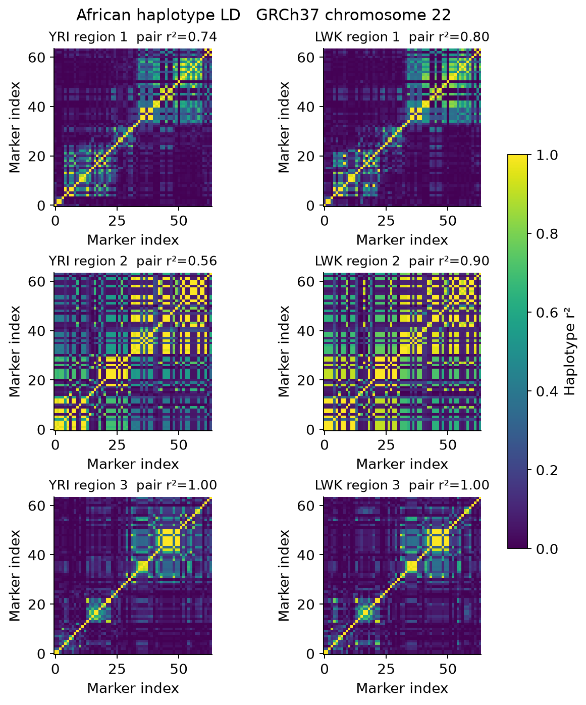

Figure 1. Study-pool squared haplotype correlations for YRI and LWK. Population labels describe the public reference samples, not simulated diagnoses or inferred ancestry in a real cohort. Diagonal blocks and perfectly correlated tags limit causal resolution.

The generating covariance decomposition further separates sharing from LD. Distinct high-LD causes can contribute covariance between the two genetic predictors while having zero same-variant contribution. Opposing shared effects instead contribute negative covariance. These are known properties of the generating mechanisms, not estimated discoveries.

| Architecture | Shared direct variants | Genetic predictor covariance | Same variant component |
| --- | --- | --- | --- |
| No genetic effect | 0 | 0.0000 | 0.0000 |
| Shared concordant | 1 | 0.0286 | 0.0286 |
| Shared opposing | 1 | -0.0286 | -0.0286 |
| Distinct low LD | 0 | -0.0002 | 0.0000 |
| Distinct high LD | 0 | 0.0259 | 0.0000 |

Table 2. Analytic generating genetic-predictor covariance averaged equally over six population-region cells. Same-variant sharing and total genetic covariance are different quantities.

### Phenotype characteristics

The realistic regime reduces complete observations to approximately 2990 of 3,200 generated participants. Observed depression prevalence is 15.3% and the mean treated fraction is 17.4% across architectures and reference strata. Pressure remains in an interpretable illustrative range while treatment, diagnostic error and missingness change its relationship with the observed depression indicator. Comorbidity also occurs in the no-genetic-effect architecture, consistent with the explicitly simulated residual dependence. Its presence alone is therefore insufficient evidence of a shared genetic cause.

| Phenotype summary | Ideal | Realistic |
| --- | --- | --- |
| Complete observations | 3200 | 2990 |
| Observed depression proxy | 15.1% | 15.3% |
| Pressure mean in illustrative mmHg | 120.9 | 119.7 |
| Pressure SD in illustrative mmHg | 12.7 | 11.1 |
| Treated fraction | 0.0% | 17.4% |
| Missing fraction | 0.0% | 6.6% |

Table 3. Mean descriptive phenotype summaries across equally weighted design cells. These are synthetic distributions, not estimated clinical prevalences.

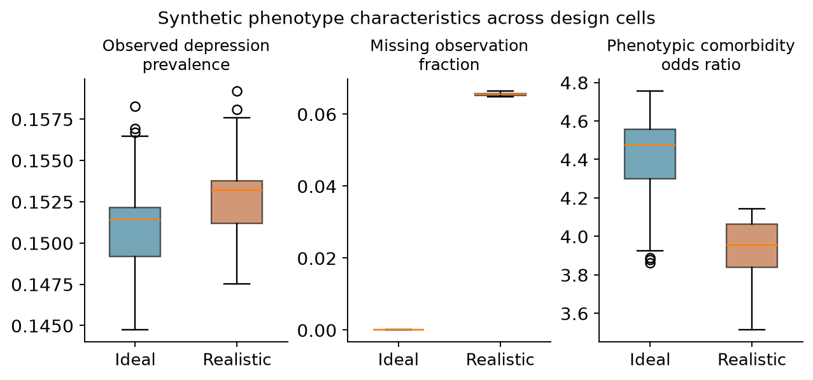

Figure 2. Distributions of replicate-averaged cell summaries. Boxes describe variation across the 48 architecture-by-population-by-region cells in each regime, rather than confidence intervals for a patient population.

### Association and sharing under ideal phenotypes

Joint association detects many trait-specific effects because its alternative includes an effect on either phenotype. Requiring both marginal associations changes the target, but distinct variants in LD can still produce a conjunction at the same marker. Under concordant shared causes, conventional colocalisation declares sharing in 89.7% of datasets. In the distinct high-LD architecture it declares sharing in 79.2%. Composite calibration addresses that ambiguity by using distinct-cause mechanisms as explicit no-sharing controls, with the corresponding power cost shown below.

| Generating architecture | Joint association | Tagging conjunction | Coloc PP4 > 0.8 | Calibrated coloc |
| --- | --- | --- | --- | --- |
| No genetic effect | 3.2% | 0.0% | 0.0% | 0.0% |
| Cardiometabolic only | 100.0% | 0.5% | 0.0% | 0.0% |
| Mental health only | 100.0% | 0.9% | 0.2% | 0.0% |
| Shared concordant | 100.0% | 100.0% | 89.7% | 25.2% |
| Shared opposing | 100.0% | 99.9% | 85.1% | 18.0% |
| Distinct low LD | 100.0% | 31.8% | 0.1% | 0.0% |
| Distinct high LD | 100.0% | 100.0% | 79.2% | 5.9% |
| Shared plus distinct | 100.0% | 100.0% | 75.2% | 15.2% |

Table 4. Ideal-regime discovery proportions. Each entry uses 1,200 evaluation datasets. Joint association and tagging conjunction have different inferential targets from colocalisation. Their rejection rates must not be interpreted as competing estimates of true pleiotropy.


Figure 3. Ideal-regime rates with calibration-aware bootstrap intervals. Higher rejection under a trait-specific architecture is expected for an omnibus association test; it is not evidence for a shared cause.

### Sharing under realistic phenotypes

Under realistic concordant shared effects, PP4 > 0.8 declares sharing in 84.2% of datasets, compared with 20.0% after composite calibration. For distinct high-LD causes, these rates are 74.8% and 3.6%. The calibrated rule therefore needs to be interpreted together with its reduced sensitivity and with the irreducible ambiguity in the third region. The shared-plus-distinct architecture is a stress test of the single-causal model, not an additional setting in which that assumption is satisfied.

| Generating architecture | Joint association | Tagging conjunction | Coloc PP4 > 0.8 | Calibrated coloc |
| --- | --- | --- | --- | --- |
| No genetic effect | 2.2% | 0.1% | 0.0% | 0.0% |
| Cardiometabolic only | 100.0% | 0.8% | 0.2% | 0.0% |
| Mental health only | 100.0% | 1.1% | 0.1% | 0.0% |
| Shared concordant | 100.0% | 100.0% | 84.2% | 20.0% |
| Shared opposing | 100.0% | 99.9% | 76.8% | 10.9% |
| Distinct low LD | 100.0% | 27.3% | 0.0% | 0.0% |
| Distinct high LD | 100.0% | 100.0% | 74.8% | 3.6% |
| Shared plus distinct | 100.0% | 100.0% | 71.7% | 14.0% |

Table 5. Realistic-regime discovery proportions, with the same 1,200-dataset denominators as Table 4.

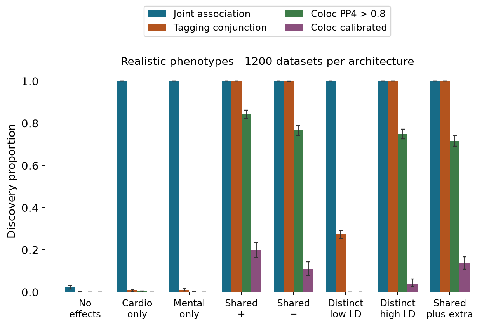

Figure 4. Realistic-regime rates with paired bootstrap uncertainty. The figure separates association discovery from shared-cause declarations and retains all simulated alternatives.

| Realistic architecture | PP4 > 0.8 with 95% interval | Calibrated coloc with 95% interval |
| --- | --- | --- |
| Shared concordant | 84.2% (82.1% to 86.2%) | 20.0% (16.2% to 23.5%) |
| Shared opposing | 76.8% (74.2% to 79.0%) | 10.9% (7.8% to 14.3%) |
| Distinct low LD | 0.0% (evaluation upper bound 0.3%) | 0.0% (evaluation upper bound 0.3%) |
| Distinct high LD | 74.8% (72.5% to 77.2%) | 3.6% (2.6% to 6.2%) |

Table 6. Aggregate colocalisation rates with percentile intervals from 400 stratified bootstrap draws for interior rates. Boundary rates show a 95% finite-evaluation bound conditional on the cutoffs, rather than a degenerate bootstrap interval. Only the bootstrap intervals include calibration-bank resampling; none are clinical effect intervals.

### Calibration under distinct causal variants

The strongest difficulty is the distinct high-LD architecture. In contrast to a null with no associations, it contains genuine signals for both traits and can give high PP4 to a shared explanation. Cell-level results show where external-reference and study LD differ and where the shared and distinct configurations cannot be distinguished. The calibrated cutoff is allowed to be stringent in these cells; reducing it to recover apparent power would invalidate the stated no-sharing control.

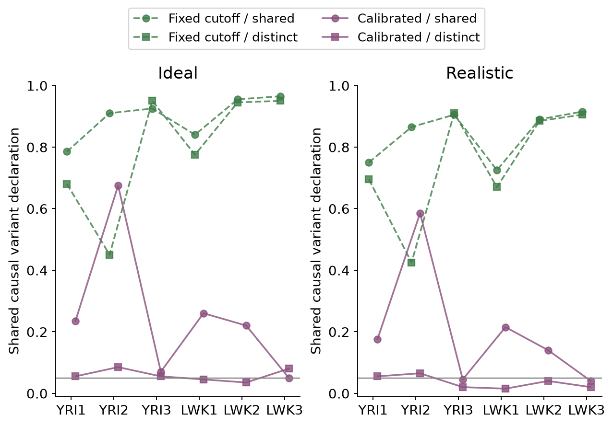

Figure 5. Shared-cause declaration rates under a genuinely shared concordant variant and under distinct high-LD variants. Region 3 has perfectly correlated causal candidates in both study populations. Differences there arise from finite calibration and evaluation samples rather than identifiable causal information.

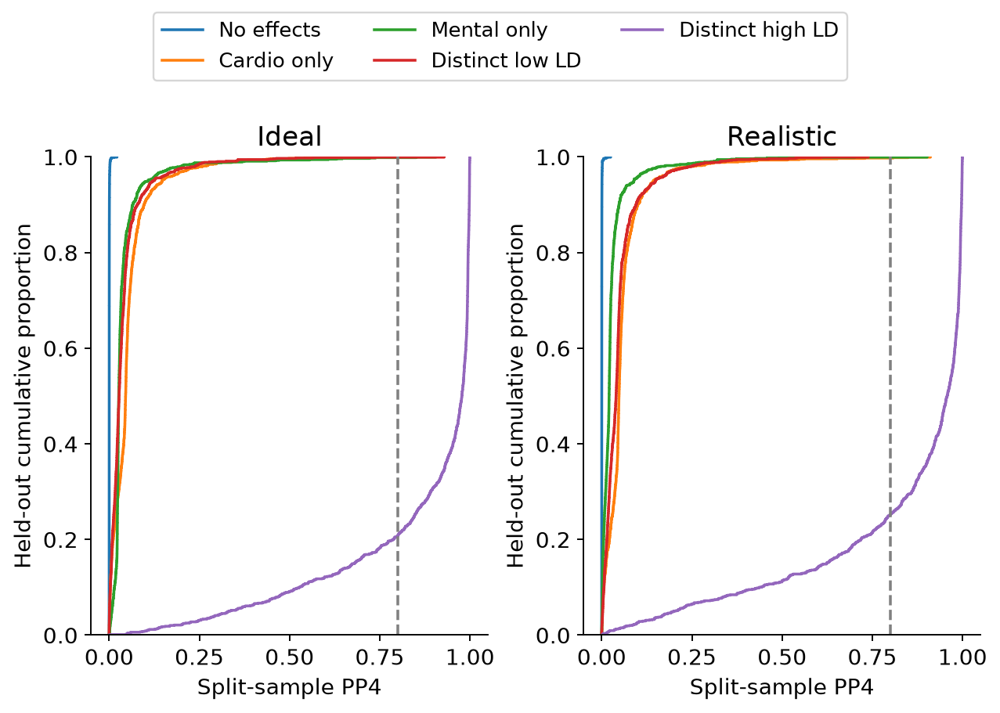

Figure 6. Held-out PP4 distributions under five mechanisms with no shared direct causal variant. The vertical line marks the conventional 0.8 rule. Strong PP4 in the high-LD distinct-cause architecture illustrates the difference between a model-based posterior and error control against realistic competing explanations.

### Prior choice and overlapping samples

Prior sensitivity changes the strength of sharing declarations, as expected from the explicit p12 multiplier in the H4 weight. The overlapping whole-sample diagnostic uses more information per phenotype than either split-sample arm and also shares estimation errors between traits. Its comparison with the primary split analysis therefore cannot isolate overlap bias. We retain it to show the consequence of a commonly used analysis choice, without presenting it as an independent confirmation of sharing.

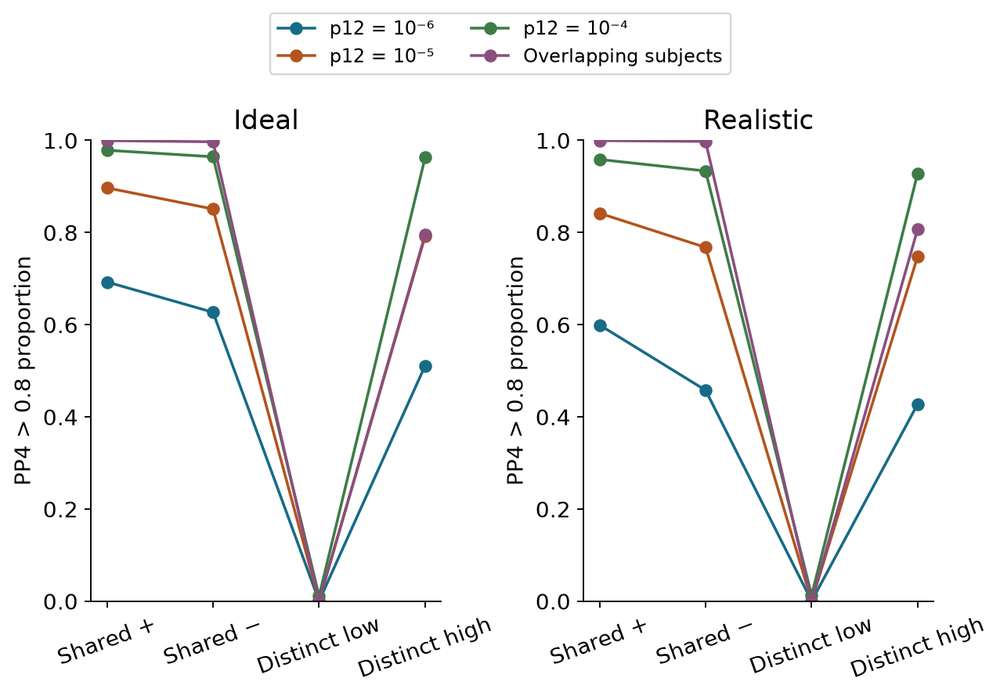

Figure 7. PP4 > 0.8 rates under three sharing priors and the overlapping whole-sample diagnostic. The latter changes both effective sample size and sampling-error dependence.

### Copula diagnostics and numerical validation

The preserved varying-dependence copula test evaluates association at the fixed anchor. Its rejection under a cardiometabolic-only effect or a distinct high-LD cause is compatible with its omnibus target. The smaller diagnostic panel does not establish a ranking of region-level power and does not turn copula dependence into genetic correlation.

| Realistic architecture | Datasets | Copula anchor p < 0.05 | Marginal joint anchor p < 0.05 |
| --- | --- | --- | --- |
| No genetic effect | 120 | 5.0% | 4.2% |
| Cardiometabolic only | 120 | 100.0% | 100.0% |
| Shared concordant | 120 | 100.0% | 100.0% |
| Distinct high LD | 120 | 100.0% | 100.0% |

Table 7. Nominal anchor tests in the realistic-regime diagnostic panel. Each entry pools 20 replicates across six population-region cells. Both procedures test association with at least one phenotype; neither is a shared-causal-variant test.

The main audit recorded 0 failed datasets out of 31,200 attempts and 0 failures among 1,920 planned copula diagnostics. All original scientific files were preserved byte-for-byte. Twelve independently selected evaluation datasets were regenerated from their seeds and matched their saved statistics to numerical tolerance. R validation independently checked full-panel regression calculations and the established coloc posterior implementation. Detailed errors, package versions, raw results, cutoffs and audit records are available in the repository.

### Multi signal colocalisation and causal resolution

The matched-subset comparison separates conventional evidence thresholds from composite-null calibrated declarations. Under realistic concordant sharing, ancestry-matched SuSiE declares a shared signal in 63.3% of the 120 evaluation datasets, compared with 86.7% for single-causal ABFs. Under distinct high-LD causes, those rates are 54.2% and 66.7%. These rates must be interpreted with the small subset size, finite reference sampling and irreducible LD ambiguity. A multi-signal method can represent additional causes but cannot identify which perfectly correlated allele generated a signal.

| Realistic architecture | Single causal rule | SuSiE pair rule | Single causal calibrated | SuSiE calibrated |
| --- | --- | --- | --- | --- |
| No genetic effect | 0.0% | 0.0% | 0.0% | 0.0% |
| Cardiometabolic only | 0.8% | 0.0% | 0.0% | 0.0% |
| Mental health only | 0.0% | 0.0% | 0.0% | 0.0% |
| Shared concordant | 86.7% | 63.3% | 21.7% | 14.2% |
| Shared opposing | 76.7% | 52.5% | 10.8% | 12.5% |
| Distinct low LD | 0.0% | 0.0% | 0.0% | 0.0% |
| Distinct high LD | 66.7% | 54.2% | 5.0% | 4.2% |
| Shared plus distinct | 68.3% | 48.3% | 13.3% | 10.8% |

Table 8. Matched 20-replicate-per-cell comparison under realistic phenotypes and ancestry-matched LD. Each entry pools 120 evaluation datasets. Both calibrated methods use the same 20-replicate no-sharing banks in this secondary comparison. A SuSiE declaration refers to any retained signal pair, not a global posterior probability.

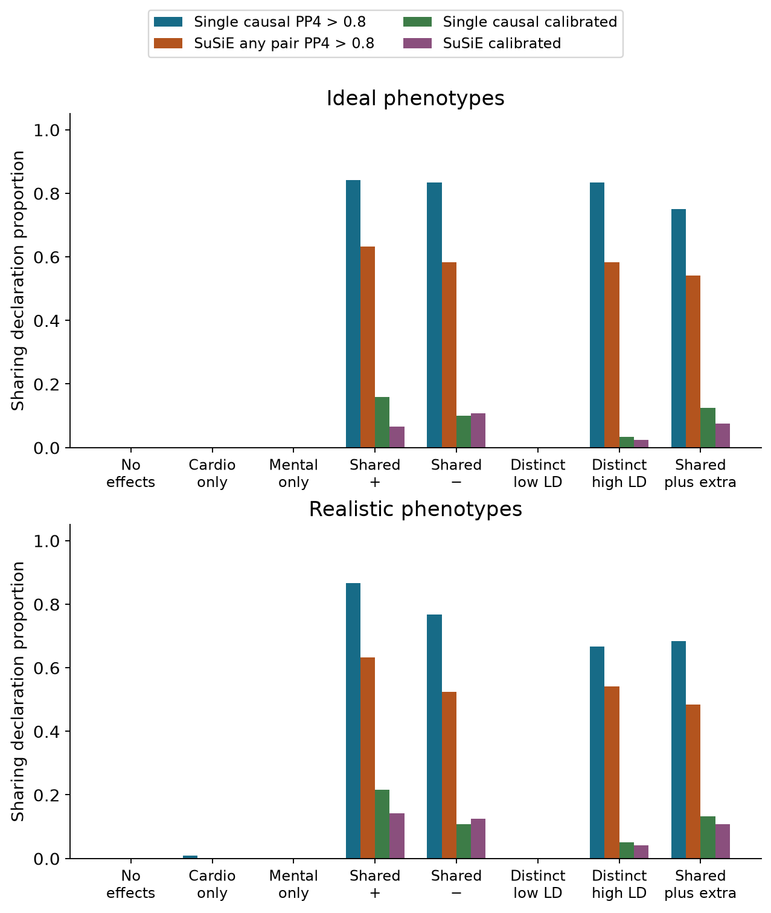

Figure 8. Matched-subset sharing declarations under ideal and realistic phenotypes. The small subset and coarse calibration support a methodological comparison rather than a claim of universal superiority. Per-cell rates and descriptive conditional intervals are published.

Credible sets describe variant resolution separately from sharing declarations. In the shared-plus-distinct architecture, recovery requires retaining the shared cardiometabolic cause and both mental-health causes. The quantities below include datasets with no retained credible set. The largest-set summaries assign size zero when no set is retained; they are descriptive and do not imply a precisely identified causal allele.

| LD source | Cardio causal recovery | Mental causal recovery | Cardio largest set | Mental largest set |
| --- | --- | --- | --- | --- |
| matched reference | 71.7% | 52.1% | 3.6 | 6.3 |
| in sample | 71.7% | 59.2% | 3.5 | 6.9 |

Table 9. Exact causal-variant recovery and mean largest retained credible-set size in the realistic shared-plus-distinct architecture. Each LD arm uses the same 120 datasets. Recovery is evaluated against known simulated causal variants.

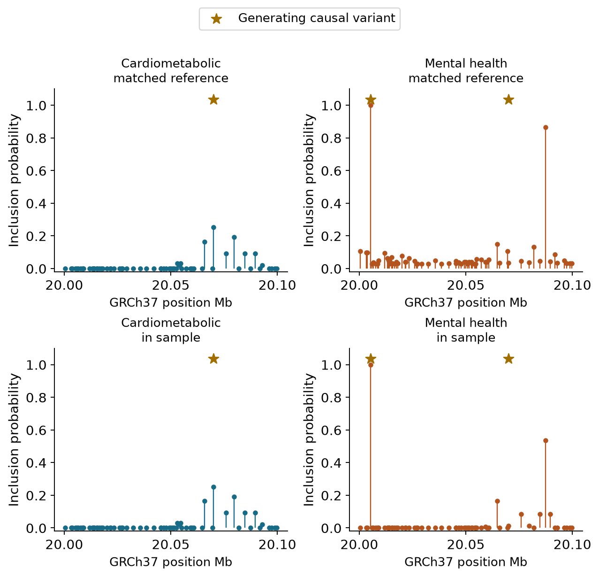

Figure 9. Variant inclusion probabilities for the prespecified first YRI replicate in region 1 under realistic shared-plus-distinct effects. Gold stars identify generating causal variants; they are simulation truth, not external annotations. The two LD sources use the same summary effects and allele orientation. This fixed example was not selected for a favourable result.

### Genome scale genetic correlation in fresh validation

The fresh observed-binary analysis estimates both positive and negative genetic correlations. At n=1,200, mean estimates are 0.502 for truth 0.5 and -0.512 for truth -0.5. For zero genetic covariance the mean is -0.002. Information-based coverage and calibrated rejection are assessed against the known generating parameters, with all attempted cohorts retained. The exact liability benchmark remains available to distinguish estimation behaviour from information lost through thresholding and diagnostic error.

| n | True genetic r | Mean estimate | RMSE | Interval coverage | Calibrated rejection |
| --- | --- | --- | --- | --- | --- |
| 600 | -0.5 | -0.509 | 0.195 | 96.2% | 74.1% |
| 600 | 0.0 | -0.013 | 0.194 | 97.0% | 3.8% |
| 600 | 0.5 | 0.515 | 0.173 | 97.7% | 77.5% |
| 1200 | -0.5 | -0.512 | 0.123 | 97.4% | 97.2% |
| 1200 | 0.0 | -0.002 | 0.135 | 96.0% | 3.9% |
| 1200 | 0.5 | 0.502 | 0.117 | 95.1% | 96.5% |

Table 10. Fresh validation of the observed binary working model. Each entry contains 800 cohorts. Interval coverage counts an unavailable interval as non-coverage; parameter summaries use converged fits, with failure counts separately reported. At zero genetic correlation the rejection rate is a false positive rate; elsewhere it is power for the specified effect size.

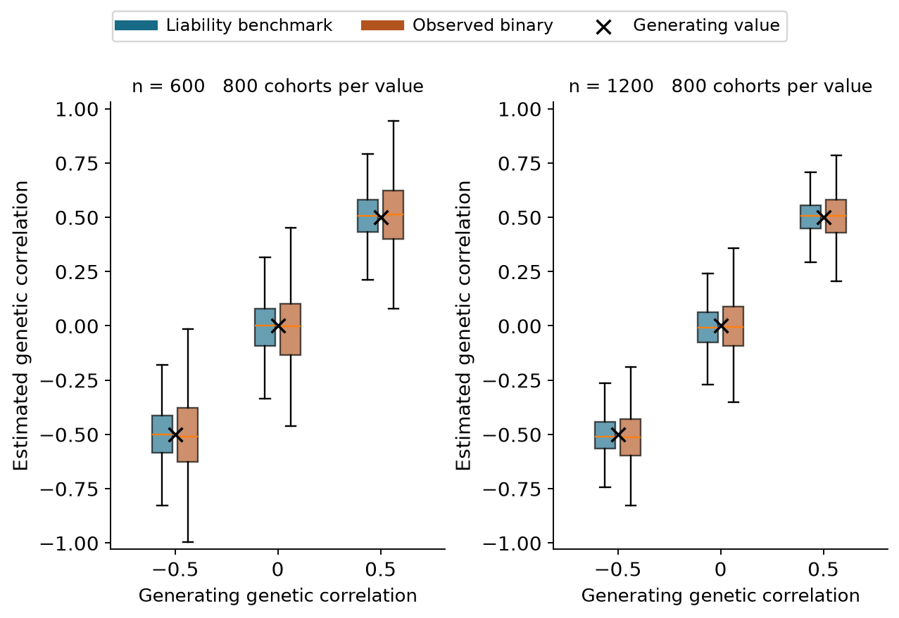

Figure 10. Distribution of genetic-correlation estimates in the fresh cohorts. Boxes show medians and interquartile ranges; whiskers extend to 1.5 interquartile ranges, with outlying points omitted from the display and retained in all calculations. The exact continuous-liability benchmark and observed binary working analysis use the same simulated cohorts. Black crosses mark generating correlations. A zero correlation parameter does not mean that no SNP affects both traits: infinitesimal effects can contribute opposing cross-trait products that cancel in aggregate.

### Separating genetic from residual dependence

The zero-genetic-correlation scenarios allow positive residual correlation, which induces observed phenotypic association. Estimating residual covariance freely avoids assigning that dependence to the genetic component by construction of the fitted model. The table reports the actual finite-simulation behaviour rather than assuming perfect separation. Its genetic correlations target a covariance component of the synthetic genome and are distinct from either the phenotypic correlation or the local copula parameter.

| n | Residual liability r | Observed phenotype r | Estimated genetic r | Calibrated null rate |
| --- | --- | --- | --- | --- |
| 600 | 0.0 | 0.001 | -0.013 | 4.0% |
| 600 | 0.4 | 0.137 | -0.013 | 3.5% |
| 1200 | 0.0 | -0.002 | -0.002 | 4.5% |
| 1200 | 0.4 | 0.138 | -0.002 | 3.2% |

Table 11. Fresh zero-genetic-correlation results, pooling the two populations within each sample-size and residual-correlation condition. Each row contains 400 independent cohorts. The residual correlation is on the generating liability scale; the observed phenotype correlation uses the binary diagnosis proxy.

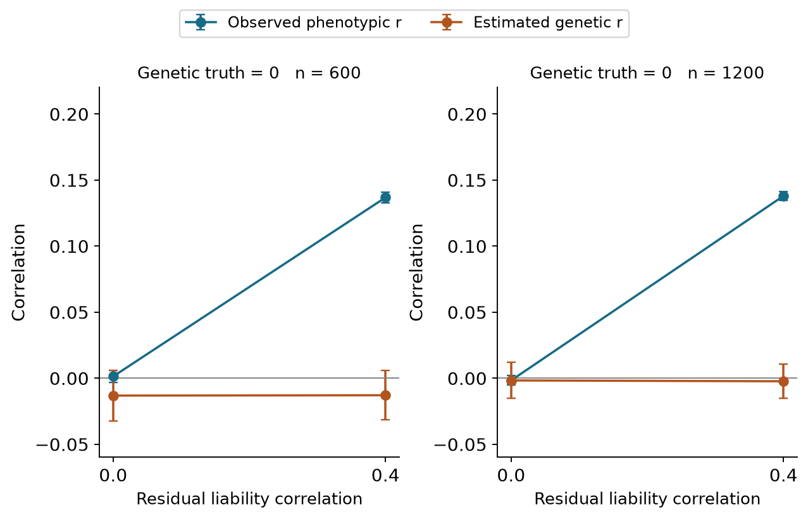

Figure 11. Observed phenotypic correlation and estimated genetic correlation when generating genetic covariance is zero. Error bars show 1.96 Monte Carlo standard errors for the stratified replicate means, conditional on the fixed kernels. Positive environmental dependence can produce comorbidity without a genetic-correlation parameter different from zero.

The larger independent calibration banks reduce threshold sampling uncertainty without guaranteeing a rejection proportion below 5% in every finite cell. In the fresh binary analysis the aggregate null rate is 3.8% at n=600 and 3.9% at n=1,200. Calibration-aware bootstrap intervals and all individual cell rates are provided. These thresholds apply to the specified synthetic model and do not validate genome-wide GWAS significance tails.

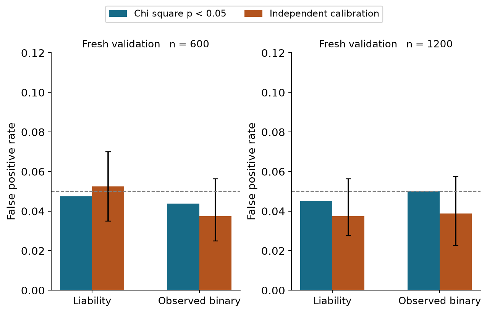

Figure 12. Fresh held-out null rejection rates for nominal chi-square tests and empirical calibration. Error bars include calibration and evaluation resampling uncertainty for the calibrated rules; the dashed line marks 0.05. The original smaller-bank results remain available for comparison.

The final extension audit includes 6,240 fine-mapping analyses and 33,600 polygenic outcome-fit records across 16,800 unique polygenic cohorts. The two outcome modes are paired observations of each cohort. Independent R checks cover both exact-liability and observed-binary likelihoods, and dedicated established-method controls verify sharing with opposing directions and signed-LD harmonisation. Fit failures and boundary counts are reported in the audit files.

## Discussion

The experiment addresses a more specific question than whether modelling two outcomes can improve an association test. The relevant question for comorbidity genetics is whether the evidence distinguishes one causal variant affecting both traits from alternative explanations. Trait-specific effects, correlated but distinct causal variants and shared residual factors all need to be represented in that assessment.

Conjunction testing supplies explicit evidence that a marker is associated with both measured traits. Its interpretation stops at marginal association: LD can transmit two different causal signals to the same tag. Colocalisation adds a model of competing causal configurations, but a single-causal posterior depends on the available variants, prior weights and the possibility of resolving their genetic patterns. Perfect LD is an identifiability limit rather than a numerical problem. More complex likelihoods cannot recover distinctions absent from the observed data.

Composite-null calibration makes that limitation visible. A high fixed posterior cutoff can appear persuasive when judged only against no genetic effects, yet perform poorly against genuinely associated distinct causes. Calibrating against those causes can improve specificity for the tested settings, at the cost of sensitivity. The present thresholds are conditional on this simulation design and should not be transferred to a real cohort or a genome-wide scan.

African genomic diversity matters here through empirical allele frequencies and LD differences between YRI and LWK and between their small reference and study pools. These observations do not justify a generic claim that African ancestry guarantees greater fine-mapping resolution. The public populations, finite donor pools and three selected windows cover a narrow part of African variation. An applied study would need cohort-specific ancestry and relatedness models, appropriate reference panels, comprehensive variant coverage, phenotype harmonisation and independent replication.

The realistic phenotype regime tests several practical departures from a simple Gaussian/probit model, but it is not a fully calibrated representation of depression, hypertension or multimorbidity in an African cohort. Treatment, diagnostic accuracy and missingness were chosen for controlled sensitivity analysis. Their consequences should motivate measurement checks in a real study rather than clinical conclusions. The binary-liability and continuous-proxy setup also leaves two-binary-disease models, repeated measurements and survival outcomes for future work.

The shared-plus-distinct architecture identifies a further model boundary. Standard ABF coloc assumes at most one cause per trait in the candidate region. The additional SuSiE comparison permits multiple signals and evaluates this limitation directly [6,7]. Its finite reference panels, LD regularisation and small comparison subset remain constraints. Multi-signal methods still face indistinguishability at perfectly correlated variants. Similarly, colocalisation cannot distinguish direct horizontal sharing from a shared signal caused through one phenotype influencing another without additional assumptions and evidence.

The polygenic experiment adds a third inferential level. Genetic covariance and correlation summarise effects across the synthetic genome; they do not identify a causal SNP, prove a disease-to-disease effect or count the fraction of variants shared between diseases. Conversely, local shared causal effects can coexist with near-zero genome-scale correlation when positive and negative contributions cancel. These targets require separate interpretation even when they are evaluated in one research programme.

The genome-scale validation is deliberately favourable in several respects: it uses common variants, 704 markers, 22 independent blocks, fixed ancestry-specific kernels and a generating covariance matched to the fitted relationship model. The continuous benchmark observes a liability that would be unavailable clinically. The binary model is explicitly a working approximation, with its error and coverage evaluated rather than assumed. These results are not evidence that the same sample sizes would give comparable precision in a real African GWAS with millions of variants, complex ascertainment or heterogeneous genetic architecture. A real application would require cohort-scale genomic QC, appropriate relationship/LD models, phenotype validation and independent replication.

The validation extension was designed after examining the first experiment's calibration uncertainty. Its new calibration and evaluation cohorts are independent, and the original findings are retained. This provides a transparent prospective check of the unchanged procedure, rather than treating a post hoc revision as an entirely preregistered study.

No real shared genetic cause of cardiometabolic and mental illness has been established here. Instead, the experiment evaluates how often specified procedures make correct or incorrect sharing declarations when the generating causes are known. This constitutes methodological evidence that could inform a prospective analysis plan for suitable real data.

## Conclusion

Public African haplotypes and realistic phenotype perturbations provide a reproducible test of shared-variant inference under known simulated mechanisms. Association with two traits is insufficient to establish a shared causal variant, and high LD can make shared and distinct causal explanations observationally equivalent. The additional multi-signal and polygenic analyses implement all three levels with distinct tests, explicit uncertainty and known synthetic truth. They define conditions under which each inference is supported and where causal resolution remains unavailable.

## Reproducibility

The frozen designs, source identities, public-reference provenance, raw simulation chunks, all evaluation tables and numerical audits are versioned. Level 2 and the initial Level 3 experiment were frozen in commit 85b0bc4; the larger-bank fresh validation was frozen separately in commit dd84837. The original study and the 92,000-dataset oracle experiment retain their own results and Word reports. The new report shares this manuscript's text, equations, figures and tables and names Vusumuzi Mabasa as author. It is generated with Pandoc and python-docx; it is not a Quarto execution.

Use Python 3.12 with the pinned root requirements, R 4.5.1, jsonlite 2.0.0 and coloc 5.2.3. Set BLAS thread counts to one when using process workers. Always run R with --vanilla. See [the complete workflow](workflow.txt) for Toshiba and Linux commands, reference retrieval, checkpoint handling, report generation and verification. The small smoke run is separate from the main results. The main analysis can take substantial time; existing chunks are reused only after source and output hashes pass validation. Public reference extraction is reproducible from the original checksum-verified files, without an absolute Toshiba path in the scientific code.

```bash
python -m pip install -r requirements.txt
python v3/src/freeze.py
python v3/src/test_model.py
python v3/src/run.py --smoke --workers 2
python v3/src/run.py --workers 2
python v3/src/analyse.py
python v3/src/audit.py --summaries
python v3/src/export_r.py
Rscript --vanilla v3/src/crosscheck.R v3
```

Primary outputs include [per-cell rates](v3/results/rates.csv), [aggregate rates](v3/results/aggregate_rates.csv), [paired comparisons](v3/results/paired_contrasts.csv), [frozen cutoffs](v3/results/thresholds.json), [phenotype checks](v3/results/phenotypes.csv), [copula diagnostics](v3/results/copula_diagnostic.csv), [reference QC](v3/reference/qc.csv) and [the complete audit](v3/results/audit.json). Uncertainty draws and independent R validations are also retained. Main simulations and bootstrap resampling are implemented in Python; independent regressions and established-method validation are performed in R. There is no Genomic SEM component.

The integrated Level 2 and Level 3 commands follow the local experiment. The full workflow explains the sequential calibration gates, R package versions, independent validation, checkpoint preservation and Word rendering. Fine-mapping is executed in R. Polygenic REML and repeated simulations are implemented in Python and independently checked in R. The original smaller-bank polygenic results remain at [the initial aggregate table](v4/results/polygenic_aggregate.csv); primary fresh validation is at [the confirmatory aggregate table](v4/results/polygenic_validation/polygenic_aggregate.csv).

```bash
python v4/src/freeze.py
python v4/src/export_finemap.py --phase cal
Rscript --vanilla v4/src/finemap.R v4 cal
python v4/src/finemap_summary.py --freeze
python v4/src/export_finemap.py --phase eval
Rscript --vanilla v4/src/finemap.R v4 eval
python v4/src/finemap_summary.py
python v4/src/polygenic.py
python v4/src/polygenic_summary.py
python v4/src/polygenic_validation.py
python v4/src/polygenic_summary.py --validation
Rscript --vanilla v4/src/check_reml.R v4
Rscript --vanilla v4/src/check_finemap.R v4
python v4/src/audit.py
python v4/src/figures.py
python v4/src/manuscript.py
python v4/src/build_word.py --pandoc /path/to/pandoc
```

These commands reuse already verified outputs in a clone. Fresh reference/kernel rebuilding and a completely fresh simulation should use a separate checkout and archived output directories, as detailed in workflow.txt. Each calibration phase must precede its evaluation. Published sources are frozen; scientific modifications belong in a new version.

## References

1. Wits University. Uncovering links between depression and hypertension in African populations. 28 August 2025. [Programme announcement](https://www.wits.ac.za/news/latest-news/research-news/2025/2025-08/uncovering-links-between-depression-and-hypertension-in-african-populations.html).
2. 1000 Genomes Project Consortium. A global reference for human genetic variation. Nature 526, 68–74 (2015). [doi:10.1038/nature15393](https://doi.org/10.1038/nature15393).
3. International Genome Sample Resource. [Public data and reuse information](https://www.internationalgenome.org/data/) and [terms of use](https://www.internationalgenome.org/IGSR_disclaimer/). Exact Phase 3 source files and SHA256 values are recorded in [the provenance file](v3/reference/provenance.json).
4. Giambartolomei C et al. Bayesian test for colocalisation between pairs of genetic association studies using summary statistics. PLoS Genetics 10, e1004383 (2014). [doi:10.1371/journal.pgen.1004383](https://doi.org/10.1371/journal.pgen.1004383).
5. Wallace C et al. [coloc single-causal-variant methods](https://chr1swallace.github.io/coloc/articles/a03_enumeration.html) and [prior sensitivity](https://chr1swallace.github.io/coloc/articles/a04_sensitivity.html). Executed established comparator: R coloc 5.2.3.
6. Wallace C. Eliciting priors and relaxing the single causal variant assumption in colocalisation analyses. PLoS Genetics 16, e1008720 (2020). [doi:10.1371/journal.pgen.1008720](https://doi.org/10.1371/journal.pgen.1008720).

7. Wallace C. A more accurate method for colocalisation analysis allowing for multiple causal variants. PLoS Genetics (2021). [Method and implementation](https://pmc.ncbi.nlm.nih.gov/articles/PMC8504726/).
8. Lee SH et al. Estimation of pleiotropy between complex diseases using single-nucleotide polymorphism-derived genomic relationships and restricted maximum likelihood. Bioinformatics (2012). [Primary publication](https://pmc.ncbi.nlm.nih.gov/articles/PMC3463125/).
9. Yang Lab. [GCTA bivariate GREML documentation](https://yanglab.westlake.edu.cn/software/gcta). Cited for methodological context; this study uses an independent implementation and R verification.
